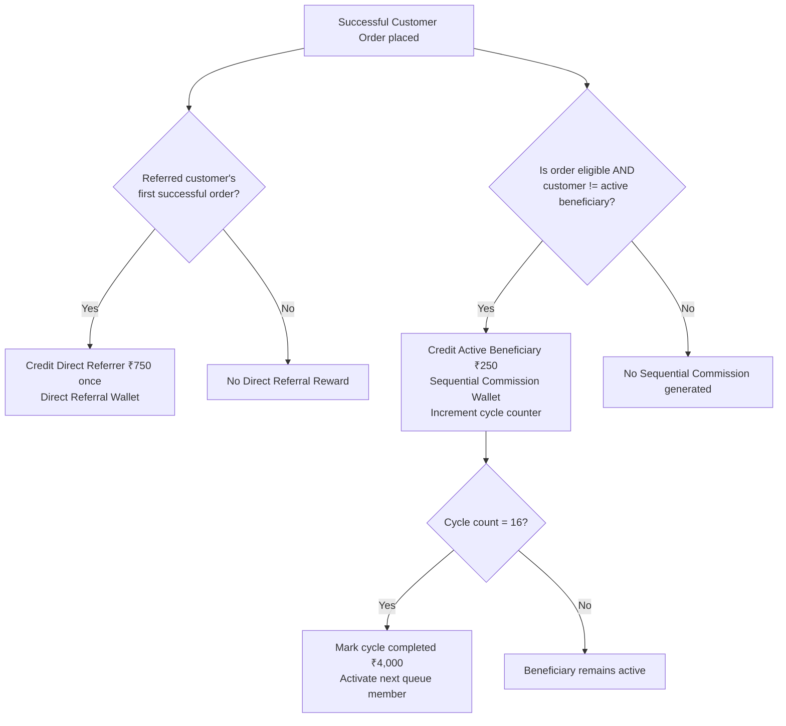
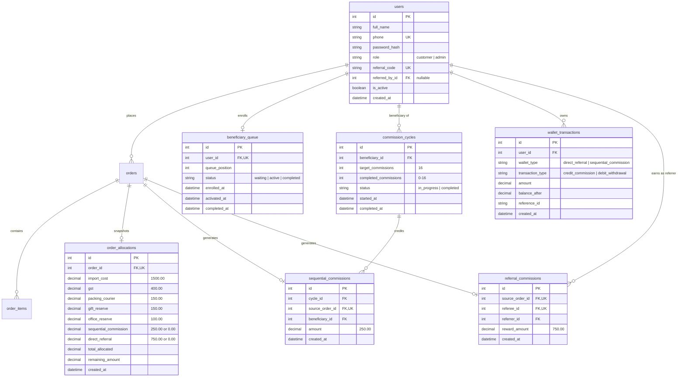

# ShopEasy — Product Requirements Document (PRD)

**Status:** Approved Requirements Baseline (Phase 1 Documentation Alignment)  
**Version:** 1.0 — Final Approved Specification  
**Project Type:** Learning and portfolio e-commerce application (Not intended for commercial production use)  
**Primary Users:** Customers and Pre-provisioned Administrators  
**Initial Purchasable Product:** Power Bank — ₹3,999  

---

## 1. Product Overview

ShopEasy is a learning and portfolio e-commerce application designed to demonstrate clean architectural boundaries, dual customer earning mechanisms, transparent ledger management, and role-based access control.

Customers can browse active products, manage a shopping cart, place orders via a simulated payment flow, track order history, maintain delivery addresses, share a unique referral code, track sequential commission progress, and simulate balance withdrawals.

Administrators manage product catalog data, inventory levels, customer records, and orders through a dedicated administrative portal.

The backend is built with Python FastAPI, using SQLAlchemy ORM and MySQL 8.0. The frontend uses standard HTML5, CSS3, and Vanilla JavaScript without heavy client frameworks.

---

## 2. Goals and Non-Goals

### 2.1 Goals
- Connect the existing customer and admin frontend prototypes to persistent FastAPI and MySQL services.
- Provide dual-mode authentication (Phone + Password or Phone + OTP) for both Customers and Pre-provisioned Administrators.
- Support core shopping workflows: catalog browsing, cart management, checkout, simulated payment, and order history.
- Implement two completely independent customer earning mechanisms:
  1. **Direct Referral Reward:** ₹750 one-time reward for the permanent direct referrer on the referee's first successful order.
  2. **Sequential Commission:** ₹250 per eligible successful order allocated to the single currently active beneficiary in a global FIFO queue (up to 16 commissions = ₹4,000 per lifetime cycle).
- Provide an auditable wallet ledger maintaining separate balances for Direct Referral and Sequential Commission earnings.
- Provide simulated, automatic full-balance withdrawals once eligibility thresholds are reached.
- Capture immutable financial allocation snapshots for every confirmed order.

### 2.2 Non-Goals
- No real payment gateway integration (Stripe, Razorpay, etc.); payments are simulated.
- No real banking or UPI payout integration; withdrawals are simulated and immediately marked successful.
- No production financial accounting, tax filing, or automated TDS deductions.
- No multi-level / upline pyramid referral tree; direct referral is strictly single-tier (1-to-1).
- No customer cancellation, product returns, or commission reversal workflows in the current scope.
- No replacement of the existing Vanilla JavaScript frontend with React, Vue, or Next.js.
- No microservices or distributed message queues; a modular monolithic FastAPI service is used.

---

## 3. Users and Roles

| Role | Provisioning | Capabilities | Restrictions & Boundaries |
| :--- | :--- | :--- | :--- |
| **Customer** | Public registration via Mobile Number + Full Name. | Register, log in (Password or OTP), browse active products, manage cart, checkout with optional referral code, view own orders, manage addresses, share referral code, track 16-circle commission progress, simulate withdrawals. | Restricted strictly to own data. Cannot access admin routes. Cannot modify referral attribution once set. Cannot self-refer. |
| **Admin** | Pre-provisioned in database/seed; no public signup. | Log in (Password or OTP with mandatory MFA), manage products (CRUD), update stock, view customer directory, view order fulfillment list, inspect order snapshots. | **Never receives a referral code.** Cannot participate in customer earning mechanisms. Cannot use customer referral codes. |

Backend authorization is authoritative. UI element visibility is never trusted for security; all protected endpoints validate JWT tokens, user active status, and role permissions.

---

## 4. Technology Stack & Architectural Constraints

| Layer | Technology | Specification / Policy |
| :--- | :--- | :--- |
| **Frontend** | HTML5, CSS3, Vanilla JavaScript | Responsive multi-page UI. Native Fetch API for REST communication. No client frameworks. |
| **Backend API** | Python FastAPI (>= 3.10) | RESTful JSON API under `/api/v1`. Modular service-oriented design. Thin route handlers. |
| **Database** | MySQL 8.0 | ACID-compliant relational storage. Foreign keys and database-level unique constraints. |
| **ORM & Migrations**| SQLAlchemy 2.0 & Alembic | Explicit schema definitions and reproducible database migrations. |
| **Data Validation** | Pydantic v2 | Strict request/response schemas. Server-side validation of all business inputs. |
| **Authentication** | Passwords (Argon2id/bcrypt) & OTP | Dual-mode login. JWT tokens for stateless session authorization. |
| **Deployment** | Render | FastAPI application serving static frontend files and API endpoints. |

---

## 5. Customer Functional Requirements

- **FR-C01 (Storefront):** Displays active catalog items. Initial launch features the single purchasable Power Bank (₹3,999).
- **FR-C02 (Product Details):** Shows name, description, price, available inventory, and product image.
- **FR-C03 (Shopping Cart):** Authenticated customers can add, update quantities, and remove items. Server validates stock and positive quantities.
- **FR-C04 (Address Management):** Customers maintain delivery addresses with full street, city, state, and pincode details.
- **FR-C05 (Checkout & Optional Referral Code):**
  - Displays selected delivery address and server-calculated price summary.
  - Features an optional **"Referral Code"** input field.
  - Server validates code existence and prohibits self-referral.
  - Customers may proceed without a referral code.
- **FR-C06 (Simulated Payment):** Customer initiates dummy payment. Successful simulation transitions order to `confirmed` status.
- **FR-C07 (Order History):** Customers inspect their past orders, historical item prices, and delivery statuses. Successfully placed orders cannot be cancelled.
- **FR-C08 (Profile & Referral Code):** Displays customer details and unique permanent referral code with one-click copy functionality.
- **FR-C09 (Customer Dashboard):**
  - Displays Total Earnings summary (Direct Referral Wallet + Sequential Commission Wallet).
  - Displays separate wallet balance cards.
  - Features the **16-circle visual progress indicator** for Sequential Commission.
  - Provides full-balance simulated withdrawal action buttons when eligibility conditions are met.

---

## 6. Administrator Functional Requirements

- **FR-A01 (Admin Dashboard):** Displays operational counts (total products, orders, customers) and prototype revenue figures.
- **FR-A02 (Product Management):** Admins can create, view, edit, activate/deactivate, and manage stock for products. Initial product is Power Bank at ₹3,999.
- **FR-A03 (Fixed Financial Allocations):** Financial allocations are fixed in backend configuration. Admins do not configure financial allocation percentages or eligibility toggles in the UI.
- **FR-A04 (Order Inspection):** Admins review order lists, historical snapshots, delivery addresses, and fulfillment states.
- **FR-A05 (Customer Directory):** Admins view registered customers, registration dates, and account statuses. Admins have no referral codes and no customer referral controls.
- **FR-A06 (Controlled Access):** Admin endpoints require active admin credentials and role validation.

---

## 7. Authentication & Account Requirements

### 7.1 Customer Authentication
- **Registration:** Requires Full Name and 10-digit Mobile Number. New accounts are automatically assigned role `customer` and a unique permanent referral code.
- **Dual Login Methods:**
  - **Method A (Phone + OTP):** User submits mobile number, receives single-use OTP (mock `123456` in local dev), verifies OTP, and receives JWT token.
  - **Method B (Phone + Password):** User submits mobile number and password. Password is verified against secure hash.
- **Password Reset:** Requires verified phone OTP before setting a new hashed password.

### 7.2 Administrator Authentication
- **Pre-provisioned Accounts:** Admin records are seeded directly in the database; no public registration endpoint exists.
- **Dual Login Methods:**
  - **Method A (Phone + OTP):** Admin verifies mobile number via OTP.
  - **Method B (Phone + Password + MFA):** Admin submits password, which immediately triggers a mandatory second-factor OTP challenge.
- **Account Safeguards:** Admin records enforce `referral_code = NULL` and `referred_by_id = NULL`.

---

## 8. Dual Customer Earning Mechanisms

The application implements two distinct, independent earning systems. They operate under separate triggers, ledgers, and payout criteria.



### 8.1 Direct Referral Reward (₹750)
1. **Trigger:** Credited only when a referred customer places their **first successful order** using a valid referral code.
2. **Attribution:** The first successful order permanently binds the purchasing customer (`referee`) to the code owner (`referrer`). Subsequent orders do not change attribution.
3. **One-Time Credit:** Exactly ₹750 is credited once per referee. Repeat purchases by the referee generate ₹0 direct referral reward.
4. **Self-Referral Prohibition:** Customers cannot use their own referral code.
5. **No Deductions:** Full ₹750 is credited to the Direct Referral Wallet; no TDS or service charge deductions apply.
6. **Withdrawal Rule:**
   - Permitted only when Direct Referral Wallet balance reaches at least **₹4,000** (e.g., after ~6 successful direct referrals).
   - Customer must withdraw the **entire available balance** (no partial withdrawals).
   - Withdrawal is simulated, automatically marked successful, and resets the wallet balance to ₹0.

---

### 8.2 Sequential Commission (₹250 per eligible order)
1. **Global Beneficiary Queue:**
   - Every customer enters the single global beneficiary queue automatically upon their **first successful order**, regardless of whether they used a referral code.
   - Queue sequence strictly follows the chronological timestamp of first successful orders (FIFO).
2. **Initial Queue Activation (Bootstrap Rule):**
   - When the first customer in system history places their first successful order, they enter the queue.
   - If the queue has no active beneficiary, that customer immediately becomes the **first active beneficiary**.
   - Their own order generates **₹0 sequential commission** and does not count toward the 16 commissions.
3. **Active Beneficiary Earning Rules:**
   - There is exactly **one active beneficiary** in the system at any given time.
   - The active beneficiary earns ₹250 from eligible successful orders placed by **other customers**.
   - The active beneficiary's own purchases generate ₹0 commission and do not increment their 16-commission counter.
4. **Cycle Target and Lifetime Limit:**
   - Target: Exactly 16 credited commissions = **₹4,000 total**.
   - Lifetime limit: Each customer can complete **only one beneficiary cycle for life**.
   - Upon crediting the 16th commission (₹4,000), the active beneficiary's cycle is marked completed and permanently closed.
   - The queue pointer automatically advances to activate the next waiting customer.
5. **Product Eligibility:**
   - The initial Power Bank (₹3,999) automatically qualifies for Sequential Commission.
   - Commission is ₹250 per eligible order, regardless of product quantity in the order.
   - Future product eligibility rules remain strictly outside the current scope.
6. **Withdrawal Rule:**
   - The completed ₹4,000 can be withdrawn in full.
   - Customer must withdraw the **entire ₹4,000** (no partial withdrawals).
   - Withdrawal is simulated, automatically marked successful, and resets the Sequential Commission Wallet to ₹0.

---

## 9. Product Financial Allocation Model

The baseline financial model is calibrated on the initial Power Bank priced at **₹3,999**.

### 9.1 Regular Fixed Per-Order Allocations (Total = ₹2,300)
Every order incurs the following standard unit reserve costs:

| Cost Item | Amount | Description |
| :--- | :---: | :--- |
| Product import cost reserve | ₹1,500 | Base manufactured unit cost |
| Output GST reserve | ₹400 | Statutory goods and services tax |
| Packing and courier reserve | ₹150 | Packaging material and transit costs |
| Gift and achievement reserve | ₹150 | Promotional incentives pool |
| Office and staff expense reserve | ₹100 | Operating overhead allocation |
| **Total Regular Allocations** | **₹2,300** | **Baseline unit allocation for every order** |

---

### 9.2 Independent Conditional Allocations
The two customer rewards are conditional and evaluated independently on each order:
1. **Sequential Commission (₹250):** Applied if an active beneficiary exists AND the ordering customer is not the active beneficiary.
2. **Direct Referral Reward (₹750):** Applied only on the referred customer's first successful order with a valid referral code.

### 9.3 The Four Financial Scenarios
Residual amounts are strictly designated as **"remaining amount after listed allocations"** (not assumed company profit):

| Scenario | Conditions | Regular Allocations | Sequential Commission | Direct Referral Reward | Total Allocation | Remaining Amount after Listed Allocations |
| :--- | :--- | :---: | :---: | :---: | :---: | :---: |
| **Scenario A** | **Both Apply:** Referred customer's first successful order with valid code, placed while another user is the active beneficiary. | ₹2,300 | ₹250 | ₹750 | **₹3,300** | **₹699** *(₹3,999 − ₹3,300)* |
| **Scenario B** | **Sequential Only:** Customer's first order placed without referral code (or any repeat order), placed while another user is active beneficiary. | ₹2,300 | ₹250 | ₹0 | **₹2,550** | **₹1,449** *(₹3,999 − ₹2,550)* |
| **Scenario C** | **Neither Applies:** Active beneficiary's own purchase placed without referral code (or repeat purchase by active beneficiary). | ₹2,300 | ₹0 | ₹0 | **₹2,300** | **₹1,699** *(₹3,999 − ₹2,300)* |
| **Scenario D** | **Direct Referral Only:** Active beneficiary's first purchase using a valid referral code. | ₹2,300 | ₹0 | ₹750 | **₹3,050** | **₹949** *(₹3,999 − ₹3,050)* |

An immutable snapshot of the applicable allocation breakdown is saved with each confirmed order record.

---

## 10. Customer Dashboard & Gamification

The customer dashboard provides transparent tracking of earning progress and wallet balances:

```
+------------------------------------------------------------------------+
| Customer Earnings Dashboard                                            |
+------------------------------------------------------------------------+
| [ Total Earnings: ₹1,250 ] [ Direct Referral: ₹0 ] [ Sequential: ₹1,250]|
+------------------------------------------------------------------------+
| Sequential Commission Progress (Active Beneficiary: 5/16 - ₹1,250 / ₹4,000)|
| (●) (●) (●) (●) (●) (○) (○) (○) (○) (○) (○) (○) (○) (○) (○) (○)       |
+------------------------------------------------------------------------+
| Direct Referral Wallet:   ₹0     [ Withdraw All (Min ₹4,000) - Disabled]|
| Sequential Wallet:        ₹1,250 [ Withdraw ₹4,000 - Disabled]         |
+------------------------------------------------------------------------+
```

### 10.1 16-Circle Progress Component
- Every customer sees 16 progress circles.
- **Active Beneficiary State:**
  - Filled green circles represent credited commissions; empty circles represent remaining commissions.
  - Displays actual counter: e.g., `5 / 16` and amount `₹1,250 / ₹4,000`.
- **Waiting / Non-Beneficiary State:**
  - Displays all 16 circles in grey/empty state.
  - Displays explicit status banner: *"You are not the current beneficiary."*
- **Completed State:**
  - Displays all 16 circles filled.
  - Displays milestone badge: *"Cycle completed — ₹4,000 earned."*

### 10.2 Wallet Balances & Simulated Withdrawal Controls
- **Direct Referral Wallet Card:**
  - Displays current balance and lifetime referrals.
  - "Withdraw Full Balance" button active only when balance $\ge$ ₹4,000.
- **Sequential Commission Wallet Card:**
  - Displays current cycle earnings.
  - "Withdraw ₹4,000" button active only when cycle is completed (balance = ₹4,000).
- **Execution:** Clicking withdraw invokes the simulated withdrawal API, decrements wallet to ₹0, logs an auditable debit transaction, and shows immediate success.

---

## 11. Order, Payment & Inventory Lifecycle

1. **Order Initiation:** Customer initiates checkout from cart, supplying address and optional referral code.
2. **Server Validation:** Backend validates product availability, positive quantities, stock level, and referral code validity (rejecting self-referral).
3. **Simulated Payment:** Frontend invokes dummy payment flow.
   - If payment fails: Order is aborted; stock is unchanged; zero reward records created.
   - If payment succeeds:
     - Order status transitions to `confirmed`.
     - Inventory stock decrements atomically.
     - Financial allocation snapshot is saved.
     - Direct referral attribution and ₹750 reward processed (if referee first order).
     - Global beneficiary queue evaluated; ₹250 sequential commission processed (if eligible).
4. **Post-Placement Integrity:**
   - Successfully placed orders cannot be cancelled by customers.
   - Returns and refunds are out of scope.
   - Duplicate order processing is strictly prevented via unique database constraints on `source_order_id`.

---

## 12. Data Architecture & Entity Specifications

The relational schema is implemented in MySQL 8.0:



---

## 13. API Route Structure

All API routes are versioned under `/api/v1`:

| Route Prefix | Resource / Purpose | Access Control |
| :--- | :--- | :--- |
| `/api/v1/auth/customer` | Customer registration, phone OTP login, phone password login, forgot password. | Public |
| `/api/v1/auth/admin` | Admin OTP login, password login with mandatory OTP MFA verification. | Public / Admin MFA |
| `/api/v1/auth/me` | Fetch authenticated user profile and permissions. | Authenticated |
| `/api/v1/products` | Public catalog browsing and product details (Power Bank ₹3,999). | Public |
| `/api/v1/cart` | Read, add, update, and remove cart items. | Customer |
| `/api/v1/addresses` | Delivery address CRUD. | Customer |
| `/api/v1/orders` | Checkout execution and personal order history. | Customer |
| `/api/v1/dashboard/earnings` | 16-circle progress, dual wallet balances, and withdrawal status. | Customer |
| `/api/v1/wallets/withdraw` | Full-balance simulated withdrawal execution. | Customer |
| `/api/v1/admin/products` | Product catalog CRUD, stock management, activation status. | Admin only |
| `/api/v1/admin/orders` | Order management and allocation snapshot inspection. | Admin only |
| `/api/v1/admin/customers` | Customer directory and account review. | Admin only |

---

## 14. Resolution of Open Decisions

All open decisions previously identified in draft documentation are formally resolved:

| Decision ID | Topic | Confirmed Resolution |
| :---: | :--- | :--- |
| **OD-01** | Sequential Commission Eligibility | Generated once per eligible order (₹250), regardless of item quantity. Does not apply to active beneficiary's own order. |
| **OD-02** | Direct Referral Reward Eligibility | Credited once (₹750) only on referred customer's first successful order using a valid code. Repeat orders generate ₹0. |
| **OD-03** | Cancellations, Returns & Refunds | Out of scope. Customer cannot cancel successfully placed orders. No refunds or commission clawbacks. |
| **OD-04** | Beneficiary Queue Enrollment | Automatic enrollment on customer's first successful order (with or without referral code). FIFO order based on timestamp. |
| **OD-05** | New Customer During Active Cycle | Order generates ₹250 for the currently active beneficiary regardless of when the purchasing customer registered. |
| **OD-06** | Initial Queue Activation | First buyer enters queue; if no active beneficiary exists, becomes the first active beneficiary. Own order gives ₹0 and doesn't count to 16. Next buyer's order generates ₹250 for them. |
| **OD-07** | Referral Reward Deductions | 100% credited (full ₹750). No TDS or service charge deductions in this learning project. |
| **OD-08** | Withdrawal Rules & Amounts | Must withdraw entire available balance. Direct Referral Wallet requires $\ge$ ₹4,000. Sequential Commission Wallet requires completed cycle (₹4,000). Resets wallet to ₹0. |
| **OD-09** | Sequential Commission Withdrawal | Fully withdrawable upon completing the 16-commission cycle (₹4,000). |
| **OD-10** | Withdrawal Simulation | Simulated in software; automatically marked successful; no real bank or UPI transfer. |
| **OD-11** | Product Financial Allocations | Fixed in backend configuration (not admin configurable). Snapshot recorded per order across the 4 independent scenarios. Residual is "remaining amount after listed allocations". |
| **OD-12** | Referral Attribution Permanence | Set permanently on first successful order with valid code. Cannot be changed. Self-referrals rejected. |
| **OD-13** | Admin Account Limitations | Admin accounts never receive referral codes, never participate in rewards, and cannot use customer referral codes. |

---

## 15. Implementation Sequence

The agreed implementation sequence proceeds as follows:
1. **Phase 1: Documentation Alignment:** Create `docs/PRD.md`, update `architeture.md`, `rules.md`, `tasks.md`, `design.md`, and `memory.md`.
2. **Phase 2: Backend Setup & Database Foundations (`TASK-004` & `TASK-005`):** Initialize FastAPI, SQLAlchemy models, and Alembic migrations.
3. **Phase 3: Authentication & Security (`TASK-006`):** Customer & Admin dual-mode auth, JWT session security.
4. **Phase 4: Product Catalog & Admin Management (`TASK-007`):** Power Bank catalog API, stock management, fixed allocation config.
5. **Phase 5: Cart, Checkout & Order Snapshot Engine (`TASK-008`):** Atomic checkout transaction, stock deduction, allocation snapshots.
6. **Phase 6: Dual Earning Engine, Queue & Simulated Withdrawals (`TASK-009`):** Direct referral processor, FIFO queue manager, wallet ledger, simulated withdrawals.
7. **Phase 7: Frontend Integration & Customer Dashboard (`TASK-010`):** Wire existing HTML/JS pages to FastAPI endpoints, build 16-circle customer dashboard and wallet UI.

