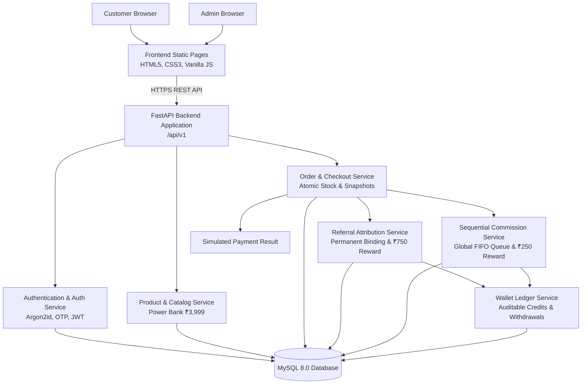
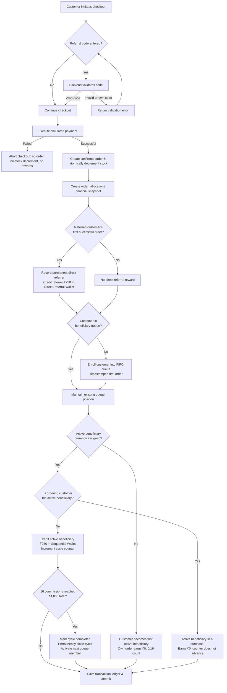
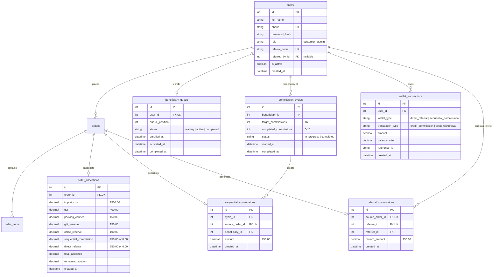

# ShopEasy — System Architecture

**Status:** Approved Architecture Baseline (Phase 1 Documentation Alignment)  
**Project Type:** Learning and portfolio e-commerce application  
**Backend:** Python FastAPI with MySQL 8.0, SQLAlchemy 2.0, Pydantic v2  
**Frontend:** HTML5, CSS3, Vanilla JavaScript (Existing responsive prototypes)  
**Initial Product:** Power Bank — ₹3,999 (Automatically eligible for Sequential Commission)  

---

## 1. Technology Stack

| Layer | Technology | Operational Role |
| :--- | :--- | :--- |
| **Customer/Admin Frontend** | HTML5, CSS3, Vanilla JavaScript | Client presentation, responsive layouts, native Fetch REST calls. |
| **Backend API** | Python FastAPI (>= 3.10) | RESTful web services, modular business logic, CORS, dependency injection. |
| **Database** | MySQL 8.0 | Relational ACID storage, foreign keys, unique constraints. |
| **ORM & Migrations** | SQLAlchemy 2.0 & Alembic | Data models, query generation, schema migrations. |
| **Validation & Schemas**| Pydantic v2 | Strict request/response payload validation and serialization. |
| **Security & Auth** | Argon2id / bcrypt, PyJWT | Dual-mode login (OTP and Password), stateless bearer tokens, role checks. |
| **Deployment Target** | Render | Unified service serving static frontend files and `/api/v1` endpoints. |
| **Payment & Payouts** | Simulated Mock Workflows | Deterministic payment simulation and full-balance simulated withdrawals. |

---

## 2. High-Level Architecture

---

## 3. Order and Dual Earning Engine Workflow

---

## 4. Logical Backend Responsibilities

### 4.1 Authentication and Authorization
- Customer authentication supports Phone + OTP or Phone + Password.
- Admin authentication supports Phone + OTP or Phone + Password followed by mandatory OTP MFA.
- Admin accounts are strictly pre-provisioned. No public admin signup.
- Admin records enforce `referral_code = NULL` and `referred_by_id = NULL`; admins cannot participate in customer referral rewards or use referral codes.
- Backend enforces role-based access control (`customer` vs `admin`) on every endpoint.

### 4.2 Product and Catalog Management
- Initial purchase flow features a single purchasable product: **Power Bank at ₹3,999**.
- The initial Power Bank automatically qualifies for the ₹250 Sequential Commission in backend configuration.
- Future products are **not** assumed to automatically qualify; dynamic product eligibility toggles and future product qualification rules are outside the current scope.
- Admin manages product details (name, description, price, stock, active status) via admin APIs.

### 4.3 Order and Checkout Processing
- Accepts checkout requests with delivery address and optional referral code.
- Server validates price, positive quantity, inventory stock, and referral code.
- Executes simulated payment flow; transitions order to `confirmed` status only on success.
- Decrements inventory stock atomically within the order database transaction.
- Captures an immutable `order_allocations` financial breakdown snapshot per confirmed order across the 4 independent financial scenarios.
- Orders cannot be cancelled by customers; returns and refunds are out of scope.

### 4.4 Referral Attribution Service
- Generates a unique, permanent referral code upon customer registration.
- Optional referral code entered during checkout is validated (prohibiting self-referral).
- On the customer's first successful order, permanently records the direct referrer.
- Later orders cannot change or override the direct referrer.
- Credits ₹750 to the direct referrer's Direct Referral Wallet once per referee. Repeat referee purchases generate ₹0 referral reward.

### 4.5 Sequential Commission Engine & Queue Manager
- Maintains a single global FIFO beneficiary queue ordered chronologically by first successful order timestamp.
- **Initial Queue Activation (Bootstrap):** The first customer placing their first successful order enters the queue and becomes the first active beneficiary if no active beneficiary exists. Their own order generates ₹0 sequential commission and does not count toward the 16 commissions.
- There is exactly one active beneficiary at a time.
- The active beneficiary earns ₹250 from eligible orders placed by other customers.
- When an active beneficiary completes 16 commissions (₹4,000), their cycle is marked completed, closed permanently, and the queue pointer automatically activates the next customer in sequence.
- Each customer completes strictly one beneficiary cycle for life.

### 4.6 Wallet Ledger & Simulated Withdrawals
- Maintains separate balances for `Direct Referral Wallet` and `Sequential Commission Wallet`.
- Summary metric: `Total Earnings = Direct Referral Wallet + Sequential Commission Wallet`.
- Records auditable credit and debit transactions for every balance modification.
- **Withdrawal Rules:**
  - Direct Referral Wallet: Requires balance $\ge$ ₹4,000; requires full-balance withdrawal; resets wallet to ₹0.
  - Sequential Commission Wallet: Requires completed cycle (₹4,000); requires full-balance withdrawal; resets wallet to ₹0.
  - Withdrawals are simulated and automatically marked successful with zero banking integration.

---

## 5. Conceptual Data Model

The following schema defines the approved relational entities in MySQL 8.0:

### Supporting E-Commerce Tables
- `products`: `id`, `name`, `sku`, `price` (3999.00), `stock`, `description`, `image_url`, `is_active`.
- `orders`: `id`, `order_number`, `customer_id`, `status`, `subtotal`, `tax`, `total_amount`, `referral_code_used`, `created_at`.
- `order_items`: `id`, `order_id`, `product_id`, `quantity`, `unit_price`, `total_price`.
- `addresses`: `id`, `user_id`, `street`, `city`, `state`, `pincode`, `is_default`.
- `cart_items`: `id`, `user_id`, `product_id`, `quantity`.
- `otp_verifications`: `id`, `phone`, `otp_hash`, `purpose`, `expires_at`, `is_used`.

---

## 6. Important Integrity Requirements

1. **Database Uniqueness:** Enforce unique constraints on `users.phone`, `users.referral_code`, `beneficiary_queue.user_id`, `sequential_commissions.source_order_id`, `referral_commissions.referee_id`, and `order_allocations.order_id`.
2. **Idempotent Rewards:** Reward processing executes inside an atomic database transaction. If an order reward was already processed, re-submission is rejected.
3. **Queue Concurrency:** Sequential cycle advancement and queue pointer updates use database row-level locking (`SELECT ... FOR UPDATE`) to prevent race conditions during concurrent order placements.
4. **Ledger Consistency:** Balances in the wallet are verifiable by summing `wallet_transactions` records for each user and wallet type.
5. **Zero Trust for Client Calculations:** Prices, discounts, commission eligibility, reward amounts, and user roles are strictly computed and enforced on the server.

---

## 7. Status of Architecture Decisions

All previously pending architecture decisions have been formally resolved by the project owner:

1. **Queue Eligibility & Ordering:** Resolved — Every customer enters automatically upon their first successful order; order follows first-purchase timestamp.
2. **Unreferred Customers in Queue:** Resolved — Customers without a referral code participate in the sequential queue identically to referred customers.
3. **Future Products & Shared Queue:** Resolved — Single initial product (Power Bank ₹3,999) automatically qualifies; future product eligibility is out of scope.
4. **Order Allocations Storage:** Resolved — Applicable breakdown snapshot is persisted per confirmed order in `order_allocations` across the 4 independent scenarios.
5. **Dashboard Balance Display:** Resolved — Separate wallet balance cards for Direct Referral and Sequential Commission, plus a combined Total Earnings card.
6. **Initial Queue Activation:** Resolved — First customer in queue becomes active beneficiary; own order generates ₹0 and doesn't count to 16; next customer's order generates ₹250.

---

## 8. Implementation Boundary

The customer and admin frontend prototypes already exist under `frontend/` and `frontend/admin/`. Phase 1 establishes complete documentation synchronization. Backend development, database creation, and API integration follow in subsequent approved tasks.
