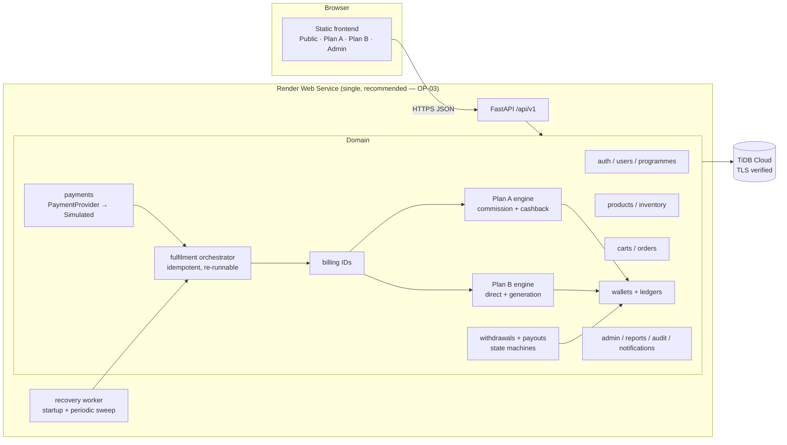
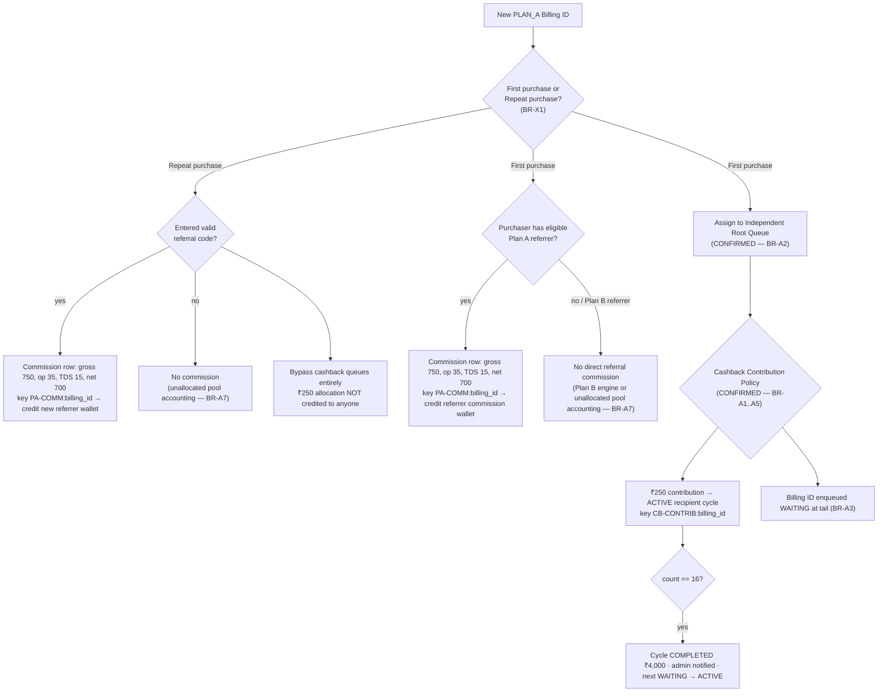
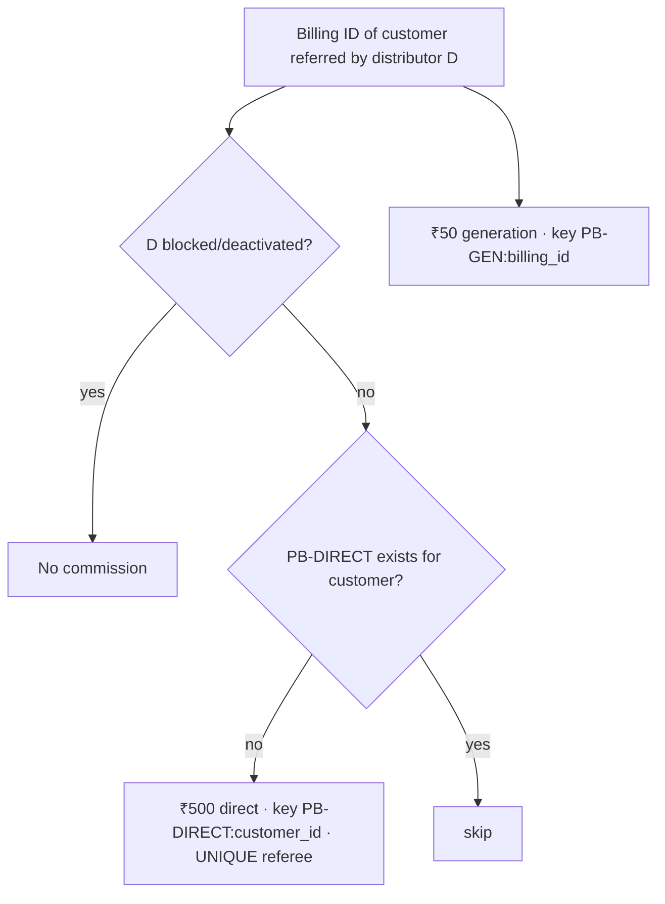
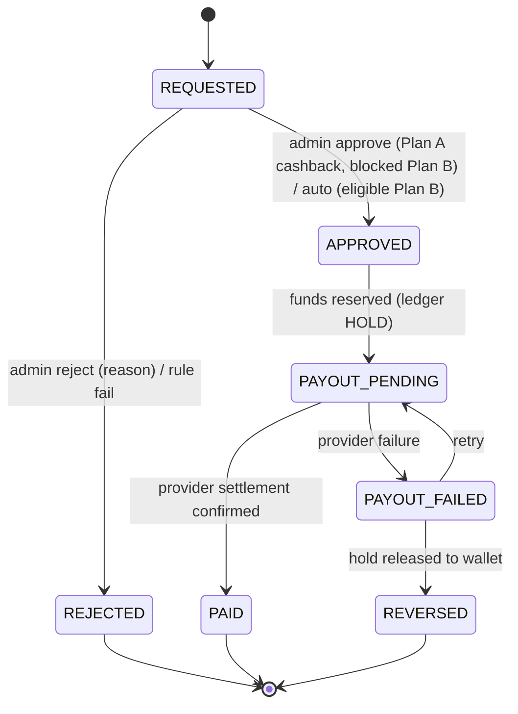
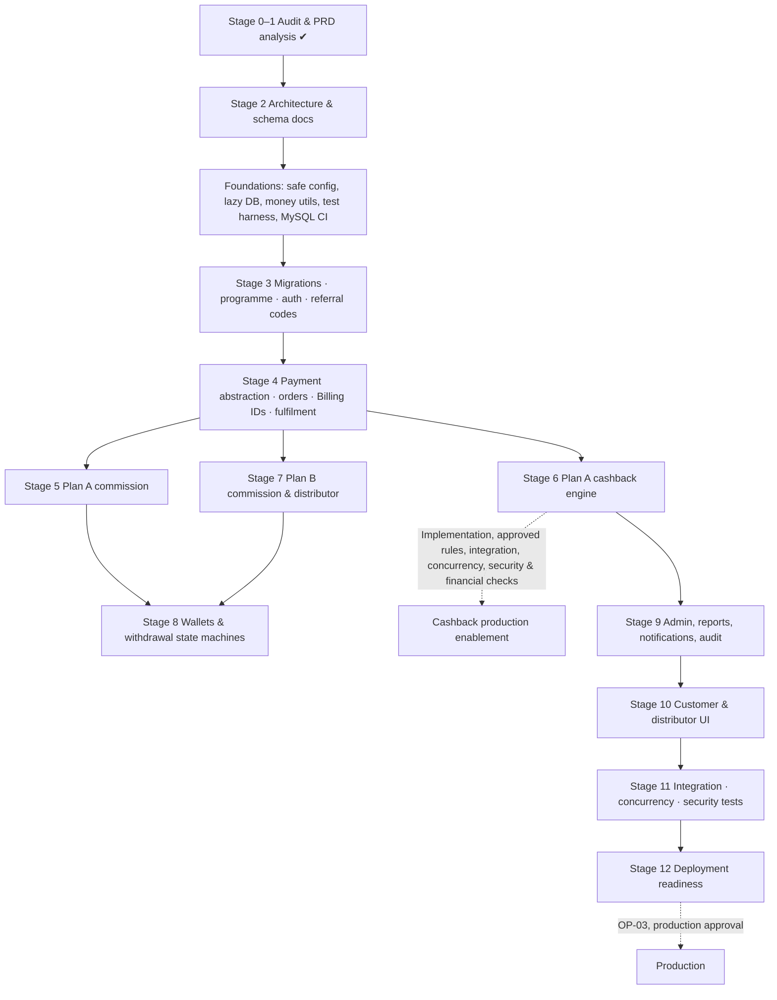

# 04 — Target Architecture & Implementation Roadmap

## 1. Strategy

**Evolve, don't rewrite.** Keep the FastAPI app, auth/security primitives, address/cart scaffolding, wallet-ledger pattern, Docker/Render packaging and the CSS system. **Replace** the earning engine (`allocation`, `earning_engine`, `queue_service`, old commission/queue tables) because its rules contradict the PRD at the schema level (`UNIQUE(referee_id)`, `CHECK(amount = 750)`, single global queue).

Legacy tables and rows are **never dropped or rewritten**. New tables are added beside them; legacy rows are tagged `LEGACY` and read-only (OP-11).

**Client-Demonstration-First Delivery & Post-Approval Integration:** The immediate delivery goal is the complete end-to-end implementation of Arya Global Digital / ShopEasy for client demonstration and review. During development and demonstration, the system utilizes simulated payment processing (`SimulatedPaymentProvider`) and development SMS/OTP authentication. Live Razorpay payment gateway integration, live SMS/OTP provider integration, production credentials/secrets configuration, and live webhook verification are explicitly scheduled as **post-client-approval activities** following formal client demonstration and sign-off. The architecture is maintained integration-ready so that live gateways and OTP services can be plugged in without refactoring checkout, authentication, or order flows. Real payment collection and live OTP delivery remain strictly disabled until these post-approval integrations are verified and formally authorized for production (R-29 / OP-13).

## 2. Target architecture



### Backend module layout (adapted to the existing `app/` package)

```text
backend/app/
  api/v1/            routers (thin)  public · customer · distributor · admin
  core/              config (safe defaults), database (lazy engine), security, money, errors, logging
  models/            existing + programme, billing, plan_a, plan_b, ledger, withdrawal, audit, notification, settings
  services/
    programmes/      programme rules registry (PLAN_A, PLAN_B)
    referrals/       code generation, validation, direction rules (BR-X3: A→B forbidden), checkout binding & repeat-order attribution (BR-X1 RESOLVED)
    payments/        provider interface, simulated provider, event ingestion
    fulfilment/      orchestrator: payment event → billing IDs → engine dispatch
    billing/         Billing ID allocator (locked counter)
    commissions/plan_a, commissions/plan_b
    cashback/        queues, cycles, contributions, policies (BR-A1..A5 interfaces)
    wallets/         ledger posting, balance cache, reconciliation
    withdrawals/     request/approval/payout state machines
    notifications/, audit/, reports/ (xlsx via openpyxl, pdf via reportlab)
  tests/             unit · integration (MySQL/TiDB) · concurrency · security · e2e
```

## 3. Core flows

### 3.1 Purchase → Billing IDs → engines

```mermaid
sequenceDiagram
  participant C as Customer
  participant API
  participant P as PaymentProvider (simulated)
  participant F as Fulfilment
  participant DB
  C->>API: POST /checkout (idempotency_key)
  API->>DB: order PENDING_PAYMENT + payment_attempt (tx)
  API->>P: create payment
  P-->>API: provider_ref
  P->>API: payment event (success) [server-side / simulated]
  API->>DB: INSERT payment_event UNIQUE(provider_event_id)
  API->>F: fulfil(order_id)
  F->>DB: BEGIN; lock order; if FULFILLED → return
  F->>DB: lock billing counter; allocate N Billing IDs (one per unit)
  F->>DB: dispatch per Billing ID → exactly one programme engine (engine_claim UNIQUE billing_id)
  F->>DB: ledger postings (idempotency keys) ; order FULFILLED; COMMIT
  Note over F,DB: Crash before COMMIT → nothing persisted; recovery worker re-runs fulfil() for PAID-but-unfulfilled orders
```

### 3.2 Plan A per Billing ID



Plan A processing distinguishes first purchases from repeat purchases under confirmed **BR-X1**:
1. **Repeat purchases (BR-X1 Confirmed):**
   - Each purchased Power Bank generates one unique Billing ID.
   - If an existing Plan A customer makes a repeat purchase using a valid referral code, the owner of that newly entered code receives ₹700 net direct commission (₹750 gross, ₹35 op cost, ₹15 TDS) per purchased Power Bank, even if the customer originally purchased using another customer's referral code.
   - Repeat-purchase Billing IDs are completely excluded from cashback queues and 16-contribution cycles: they do not join a queue, cannot become cashback recipients, and their ₹250 cashback allocation is not credited to anyone.
   - Previously completed cashback cycles and existing Billing ID records remain unchanged.
2. **First purchases (BR-A2 Confirmed):**
   - Queue assignment is confirmed and resolved under **BR-A2**: each new Plan A first-purchase Billing ID is assigned to its isolated independent root queue (unreferred customers start a new queue; referred customers join their root customer's queue; downline referrals stay within that root queue; a Plan A customer using a Plan B referral starts an independent Plan A queue).
   - Initial queue unallocated contribution is resolved under **BR-A4 (Option A Confirmed)**: when the first eligible Billing ID enters a brand-new cashback queue and there is no eligible recipient ahead of it, its ₹250 contribution is recorded as unallocated, belongs permanently to the company in the unallocated cashback reserve, is never paid to or transferred to any customer, and does not count towards the customer's own cycle. The admin dashboard must display: total unallocated cashback amount, queue-wise breakdown, original Billing ID and customer reference, date reserved, and status `UNALLOCATED — COMPANY OWNED`, supported by traceable financial records.
   - Recipient own-purchase exclusion is resolved under **BR-A5 (Option A Confirmed — Company-Owned Unallocated Reserve)**: when the active cashback recipient makes another eligible Power Bank purchase, the resulting ₹250 contribution is permanently allocated to the company-owned unallocated cashback reserve. Rules: (1) The purchaser must never contribute to their own cashback cycle; (2) The ₹250 must be recorded in the company-owned unallocated reserve; (3) It must never be transferred or credited to another customer; (4) It remains company-owned permanently; (5) It must not increment the purchaser's own cycle contribution count; (6) A traceable financial ledger record must identify the Billing ID, customer, queue, amount, date and reserve status; (7) The admin dashboard must display the amount in the total unallocated reserve and its queue-wise breakdown.
   - Multiple Billing IDs contribution is resolved under **BR-A1 (Confirmed)**: every eligible Billing ID contributes to the cashback system; if the same customer purchases multiple Power Banks, each eligible Billing ID contributes separately; contributions are not restricted to one per customer.
   - Contributor role and queue joining is resolved under **BR-A3 (Confirmed)**: each eligible Billing ID first contributes to the current active recipient; after that contribution, the purchaser joins the queue as WAITING. Existing queue and sequential-cycle rules are preserved.
   - All Plan A cashback rules (BR-A1, BR-A2, BR-A3, BR-A4 Option A, BR-A5 Option A, BR-A6, BR-X1) are now fully confirmed and resolved. No blocking decisions remain for WP-10.

Separately, the ₹700 direct-referral commission is strictly decoupled from the ₹250 cashback cycle: eligible referred purchases credit ₹700 net to the immediate eligible referrer, while accounting treatment for the unallocated ₹750 gross commission pool on unreferred purchases is tracked separately under **BR-A7**.

### 3.3 Plan B per Billing ID (purchaser referred by a Plan B distributor)



### 3.4 Withdrawal state machines



Plan B wallet freeze is an orthogonal flag: frozen ⇒ `REQUESTED` cannot be created; credits continue.

## 4. Data model additions (summary; full DDL in `DATABASE_DESIGN.md` at Stage 2)

| Table | Key constraints |
|---|---|
| `programme` enum on `users` (+ `account_status` ACTIVE/BLOCKED/DEACTIVATED) | phone UNIQUE (global) |
| `referral_relationships` | UNIQUE(referee_user_id); referrer/referee programme direction check in service |
| `payment_attempts`, `payment_events` | UNIQUE(provider, provider_event_id); `is_simulated` flag |
| `billing_counters` (single row per sequence) | locked `FOR UPDATE` |
| `billing_ids` | UNIQUE(billing_number); FK order_item, user; programme; status |
| `billing_engine_claims` | UNIQUE(billing_id) — one engine per Billing ID |
| `financial_settings` (versioned) | effective_from; rates DECIMAL(9,6) |
| `pa_commissions` | UNIQUE(billing_id); gross/op/tds/net; settings_version |
| `pa_cashback_queues`, `pa_queue_members`, `pa_cashback_cycles`, `pa_cashback_contributions` | UNIQUE(contributor billing_id); UNIQUE(cycle_id, seq_no); UNIQUE(queue_id, position) |
| `pb_commissions` | UNIQUE(type='DIRECT', referee_id) via `direct_key`; UNIQUE(type='GEN', billing_id) |
| `wallet_accounts` (programme, kind: PA_COMMISSION / PA_CASHBACK / PB_DISTRIBUTOR) + `ledger_entries` | UNIQUE(idempotency_key); append-only |
| `withdrawal_requests`, `payout_transactions` | one active request per (wallet) / per (cycle) |
| `wallet_freeze_history`, `account_status_history`, `audit_logs`, `notifications`, `inventory_movements`, `delivery_status` | append-only |

## 5. Dependency graph



## 6. Prioritised plan

| # | Work package | Depends on | Blocked by | Output |
|---|---|---|---|---|
| WP-0 | Fix S1–S3 unsafe defaults (prod refuses to start with dev OTP/default secret/DEBUG); lazy engine creation (S10) | — | — | Safer config + tests |
| WP-1 | Test harness: pytest, fixtures, MySQL 8 container (docker-compose) + TiDB-compat notes; GitHub Actions | WP-0 | Docker daemon locally | Green CI skeleton |
| WP-2 | Money utilities, financial settings (versioned) | WP-1 | — | Rounding tests (750→35/15/700) |
| WP-3 | Migration A: programme, account status, referral_relationships, audit, notifications (additive) | WP-1 | — | Upgrade/downgrade tests |
| WP-4 | Registration with programme selection, programme-aware login, referral codes, direction rules | WP-3 | — (BR-X1, BR-X3 resolved) | API + tests; direction enforcement (BR-X3: Plan A cannot refer Plan B, code rejected, no commission/cashback; B→A allowed per BR-A2; existing Plan A and Plan B referral rules preserved); checkout referral entry confirmed; repeat-purchase referral attribution resolved per BR-X1 (new code owner receives ₹700 net per unit; repeat Billing IDs bypass cashback queues and cycles; zero ₹250 credit) |
| WP-5 | Payment abstraction, payment events, simulated provider guard | WP-3 | — | |
| WP-6 | Billing ID allocator + fulfilment orchestrator + recovery worker | WP-5 | — | Concurrency tests |
| WP-7 | Plan A commission engine | WP-6, WP-2 | BR-A7 (for unallocated ₹750 pool accounting only) | Confirmed ₹700 net direct commission to immediate referrer implementable (₹750 gross, ₹35 op cost, ₹15 TDS per eligible Billing ID; immediate referrer only; repeat orders award ₹700 net to new code owner per BR-X1); accounting treatment for unallocated ₹750 pool (unreferred orders) pending BR-A7 |
| WP-8 | Plan B commission engine, distributor status, freeze | WP-6 | — | ₹500/₹50 tests (BR-B1, BR-X2, BR-B2, BR-B3 resolved) |
| WP-9 | Wallet ledger + withdrawal state machines + sandbox payouts | WP-7, WP-8 | — | BR-A6 resolved (separate commission min ₹700 & cashback full ₹4,000); BR-B2 resolved |
| WP-10 | Plan A cashback: queues/cycles/contributions/policy interfaces, bulbs API | WP-6 | — (BR-A1, BR-A2, BR-A3, BR-A4 Option A, BR-A5 Option A resolved) | All Plan A cashback rules confirmed: BR-A1 (every eligible Billing ID contributes separately; no 1-per-customer limit); BR-A2 (1 Billing ID per unit, independent root queues, sequential cycle); BR-A3 (contributes to active recipient first, then joins queue as WAITING); BR-A4 Option A (first Billing ID ₹250 contribution in a new queue permanently retained as company-owned unallocated cashback reserve, traceable in financial records); BR-A5 Option A (recipient own-purchase exclusion: active recipient's own subsequent purchase ₹250 permanently allocated to company-owned unallocated reserve, never transferred or credited to another customer, traceable in financial records); BR-A7 concerns unallocated ₹750 commission pool accounting only and does NOT block the cashback engine |
| WP-11 | Admin APIs + reports (xlsx/pdf) + notifications | WP-9, WP-10 | — | Includes dedicated Unallocated Cashback Reserve section per confirmed BR-A4 Option A: total unallocated amount, queue-wise breakdown, original Billing ID, customer ref, date reserved, and status `UNALLOCATED — COMPANY OWNED` supported by traceable financial records |
| WP-12 | Frontend: Arya rebrand, programme registration, Plan A/B dashboards, 48-bulb grid, admin console | WP-11 | — | UI tests (Playwright) |
| WP-13 | Security & concurrency hardening, reconciliation job | all | — | SECURITY_REVIEW, FINANCIAL_RECONCILIATION |
| WP-14 | Deployment package (render.yaml, runbooks, backups) | WP-13 | OP-03 resolved | DEPLOYMENT_GUIDE (Demo build) |
| Post-Demo Gate | Client demonstration, review and formal acceptance of completed system | WP-14 | Client sign-off | Client Approval & Integration Authorization |
| Post-Approval 1 | Razorpay payment gateway integration, webhook signature verification | Post-Demo Gate | — | Real payment gateway provider implementation |
| Post-Approval 2 | Live SMS/OTP provider integration, production credentials & secrets configuration | Post-Demo Gate | — | Real OTP delivery + rate-limiting & provider tests |
| Post-Approval 3 | Production end-to-end payment/auth verification, security review, reconciliation | Post-Approval 1, 2 | BR-T1 (accountant) | Production Launch Readiness |

## 7. Test strategy

| Layer | Tooling | Scope |
|---|---|---|
| Unit | pytest | Money rounding, rate versions, policy functions, bulb maths, state machines |
| Integration | pytest + **MySQL 8 container** (primary), SQLite only for pure-unit speed | Every engine through real SQL, constraints, locks |
| TiDB compatibility | Same suite against a non-production TiDB Cloud dev cluster (manual gate) | CHECK/FK enforcement, locking, AUTO_INCREMENT behaviour |
| Concurrency | Thread pool of N sessions hitting fulfilment simultaneously | Billing ID uniqueness, FIFO ordering, no double credit |
| Idempotency / replay | Re-deliver payment events ×N; double-click approvals | Zero duplicate rows |
| Crash recovery | Fault injection between steps; restart; recovery worker | Exactly-once outcome |
| Security | pytest + httpx | AuthN/Z, IDOR across users & programmes, injection payloads, rate limits, secret scan |
| UI | Playwright (Python) | Registration per programme, checkout notice, dashboards, 48 bulbs (0/9/24/48), mobile 375px |
| Reports | openpyxl/pdf parsing | Report totals == ledger totals |
| Migration | Alembic upgrade → downgrade → upgrade on populated legacy DB snapshot | No legacy row lost/changed |

Reports: `pytest --junitxml` + `pytest-html` consolidated report under `reports/`. **No feature is marked COMPLETE without a linked passing test.**

## 8. Risk assessment

| ID | Risk | Likelihood | Impact | Mitigation |
|---|---|---|---|---|
| RK-01 | Treatment of unallocated ₹750 commission pool (BR-A7) unconfirmed | Medium | Medium | BR-A7 blocks only unallocated commission pool accounting (does not block cashback engine or confirmed ₹700 direct-referral commission); escalate exact accounting mechanics |
| RK-02 | Referral repeat-order attribution rule & queue routing (BR-X1 RESOLVED); Plan B ₹500 timing (BR-B1 RESOLVED) | Low | Low | BR-X1 confirmed: repeat orders credit newly entered referral code ₹700 net per Power Bank; repeat Billing IDs bypass cashback queues and cycles with zero ₹250 credit; single-referrer constraint updated for repeat-purchase transaction attribution |
| RK-03 | TiDB silently ignores CHECK/FK | High | High | Service-level invariants + reconciliation job + TiDB test gate |
| RK-04 | Legacy data in old system is non-operational test data | Low | Low | OP-11 resolved: clean database for new system; old test data archived untouched |
| RK-05 | Global locks become throughput bottleneck | Medium | Medium | Per-queue locks, short transactions, lock ordering; load test |
| RK-06 | Simulated payment accidentally active in production | Low | Critical | Startup guard + `is_simulated` on every payment row + UI banner |
| RK-07 | Tax treatment changes (GST/TDS) | Medium | Medium | Versioned settings; rate stored per row |
| RK-08 | XSS → token theft (localStorage) | Medium | High | Output encoding audit, CSP, consider HttpOnly cookie + CSRF token |
| RK-09 | Render ephemeral disk loses product images | High | Low | Product images fixed per PRD → commit as static assets or object storage |
| RK-10 | Scope size vs. verification effort | High | Medium | Strict stage gates; progress doc; small commits |
| RK-11 | No local MySQL/Docker running in dev env | Current | Medium | Start Docker Desktop or provide a dev TiDB cluster before WP-1 integration tests |

## 9. Approval gates (work stops here until the client confirms)

1. BR-A7 → before production enablement of unallocated commission pool handling (accounting treatment of unallocated ₹750 commission pool when purchaser has no referrer). Does not block cashback engine or confirmed ₹700 direct-referral commission calculation.
2. [Resolved] BR-B1, BR-X2, BR-B2, BR-B3 confirmed for Plan B commission rules; BR-X1 confirmed for Plan A repeat purchases (new code owner receives ₹700 net per unit; repeat Billing IDs excluded from cashback queues/cycles; ₹250 not credited); BR-X3 confirmed: Plan A participants cannot refer Plan B participants (A→B forbidden, no commission/cashback; B→A allowed per BR-A2; existing Plan A and Plan B referral rules preserved).
3. [Resolved] BR-A6 (separate commission min ₹700 & cashback full ₹4,000) and BR-B2 confirmed for withdrawals. Operational gate: formal accountant verification (BR-T1) required before production payouts are enabled.
4. [Resolved] OP-11 confirmed: clean database for new system; old test data archived untouched.
5. OP-03 resolved (single Render Web Service); formal authorization before production deployment.
6. [Resolved: R-29 / OP-13] Client demonstration before live payment and OTP integration: Full system demonstration and formal written approval by the client is required before initiating live Razorpay payment gateway integration, live SMS/OTP provider integration, production credentials configuration, and production launch. Real payments and live OTP delivery remain disabled throughout development and client demonstration.
