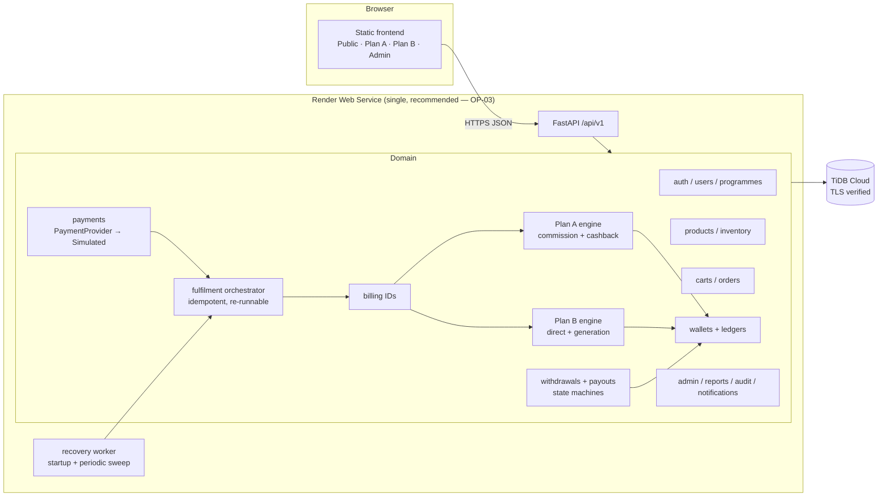
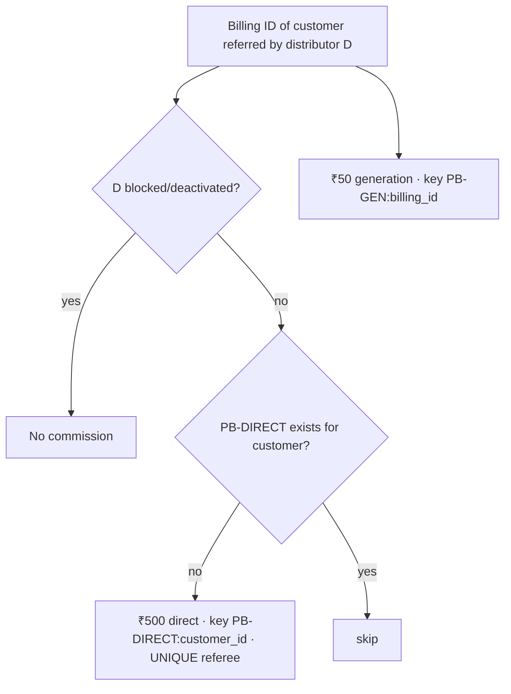
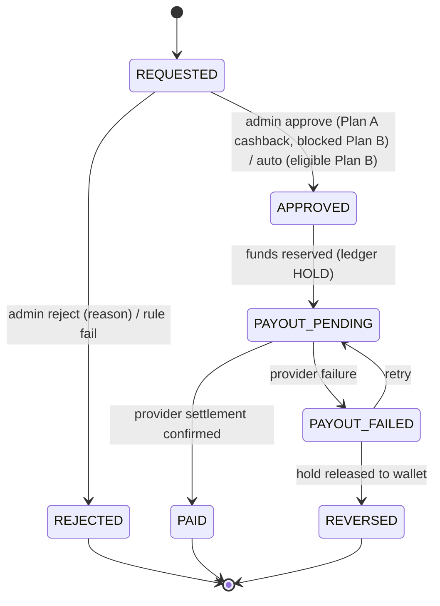
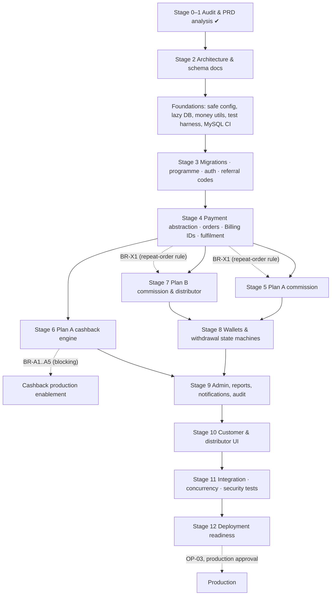

# 04 — Target Architecture & Implementation Roadmap

## 1. Strategy

**Evolve, don't rewrite.** Keep the FastAPI app, auth/security primitives, address/cart scaffolding, wallet-ledger pattern, Docker/Render packaging and the CSS system. **Replace** the earning engine (`allocation`, `earning_engine`, `queue_service`, old commission/queue tables) because its rules contradict the PRD at the schema level (`UNIQUE(referee_id)`, `CHECK(amount = 750)`, single global queue).

Legacy tables and rows are **never dropped or rewritten**. New tables are added beside them; legacy rows are tagged `LEGACY` and read-only (OP-11).

## 2. Target architecture



### Backend module layout (adapted to the existing `app/` package)

```text
backend/app/
  api/v1/            routers (thin)  public · customer · distributor · admin
  core/              config (safe defaults), database (lazy engine), security, money, errors, logging
  models/            existing + programme, billing, plan_a, plan_b, ledger, withdrawal, audit, notification, settings
  services/
    programmes/      programme rules registry (PLAN_A, PLAN_B)
    referrals/       code generation, validation, direction rules, checkout binding (BR-X1)
    payments/        provider interface, simulated provider, event ingestion
    fulfilment/      orchestrator: payment event → billing IDs → engine dispatch
    billing/         Billing ID allocator (locked counter)
    commissions/plan_a, commissions/plan_b
    cashback/        queues, cycles, contributions, policies (BR-A1..A5 interfaces)
    wallets/         ledger posting, balance cache, reconciliation
    withdrawals/     request/approval/payout state machines
    notifications/, audit/, reports/ (xlsx via openpyxl, pdf via reportlab)
  tests/             unit · integration (MySQL/TiDB) · concurrency · security · e2e
```

## 3. Core flows

### 3.1 Purchase → Billing IDs → engines

```mermaid
sequenceDiagram
  participant C as Customer
  participant API
  participant P as PaymentProvider (simulated)
  participant F as Fulfilment
  participant DB
  C->>API: POST /checkout (idempotency_key)
  API->>DB: order PENDING_PAYMENT + payment_attempt (tx)
  API->>P: create payment
  P-->>API: provider_ref
  P->>API: payment event (success) [server-side / simulated]
  API->>DB: INSERT payment_event UNIQUE(provider_event_id)
  API->>F: fulfil(order_id)
  F->>DB: BEGIN; lock order; if FULFILLED → return
  F->>DB: lock billing counter; allocate N Billing IDs (one per unit)
  F->>DB: dispatch per Billing ID → exactly one programme engine (engine_claim UNIQUE billing_id)
  F->>DB: ledger postings (idempotency keys) ; order FULFILLED; COMMIT
  Note over F,DB: Crash before COMMIT → nothing persisted; recovery worker re-runs fulfil() for PAID-but-unfulfilled orders
```

### 3.2 Plan A per Billing ID

```mermaid
flowchart TD
  B[New PLAN_A Billing ID] --> R{Purchaser has eligible<br/>Plan A referrer?}
  R -- yes --> COM[Commission row: gross 750, op 35, TDS 15, net 700<br/>key PA-COMM:billing_id → credit referrer commission wallet]
  R -- "no / Plan B referrer" --> UN[No Plan A commission<br/>(Plan B engine or UNALLOCATED — BR-A7)]
  B --> Q{QueueAssignmentPolicy<br/>BR-A2}
  Q -- "policy not approved" --> HOLD[Contribution held: PENDING_POLICY<br/>no customer credit]
  Q -- approved --> CP{ContributorPolicy BR-A1/A3/A5}
  CP --> CTR[₹250 contribution → ACTIVE recipient cycle<br/>key CB-CONTRIB:billing_id]
  CTR --> DONE{count == 16?}
  DONE -- yes --> COMP[Cycle COMPLETED ₹4,000 · admin notified · next WAITING → ACTIVE]
  CP --> ENQ[Billing ID enqueued WAITING at tail]
```

When the cashback policy is unapproved, contributions are recorded as `PENDING_POLICY` obligations (not credited) so that **no purchase loses its ₹250 entitlement** and they can be allocated once rules are confirmed — this needs client acknowledgement (BR-A1..A4).

### 3.3 Plan B per Billing ID (purchaser referred by a Plan B distributor)



### 3.4 Withdrawal state machines



Plan B wallet freeze is an orthogonal flag: frozen ⇒ `REQUESTED` cannot be created; credits continue.

## 4. Data model additions (summary; full DDL in `DATABASE_DESIGN.md` at Stage 2)

| Table | Key constraints |
|---|---|
| `programme` enum on `users` (+ `account_status` ACTIVE/BLOCKED/DEACTIVATED) | phone UNIQUE (global) |
| `referral_relationships` | UNIQUE(referee_user_id); referrer/referee programme direction check in service |
| `payment_attempts`, `payment_events` | UNIQUE(provider, provider_event_id); `is_simulated` flag |
| `billing_counters` (single row per sequence) | locked `FOR UPDATE` |
| `billing_ids` | UNIQUE(billing_number); FK order_item, user; programme; status |
| `billing_engine_claims` | UNIQUE(billing_id) — one engine per Billing ID |
| `financial_settings` (versioned) | effective_from; rates DECIMAL(9,6) |
| `pa_commissions` | UNIQUE(billing_id); gross/op/tds/net; settings_version |
| `pa_cashback_queues`, `pa_queue_members`, `pa_cashback_cycles`, `pa_cashback_contributions` | UNIQUE(contributor billing_id); UNIQUE(cycle_id, seq_no); UNIQUE(queue_id, position) |
| `pb_commissions` | UNIQUE(type='DIRECT', referee_id) via `direct_key`; UNIQUE(type='GEN', billing_id) |
| `wallet_accounts` (programme, kind: PA_COMMISSION / PA_CASHBACK / PB_DISTRIBUTOR) + `ledger_entries` | UNIQUE(idempotency_key); append-only |
| `withdrawal_requests`, `payout_transactions` | one active request per (wallet) / per (cycle) |
| `wallet_freeze_history`, `account_status_history`, `audit_logs`, `notifications`, `inventory_movements`, `delivery_status` | append-only |

## 5. Dependency graph



## 6. Prioritised plan

| # | Work package | Depends on | Blocked by | Output |
|---|---|---|---|---|
| WP-0 | Fix S1–S3 unsafe defaults (prod refuses to start with dev OTP/default secret/DEBUG); lazy engine creation (S10) | — | — | Safer config + tests |
| WP-1 | Test harness: pytest, fixtures, MySQL 8 container (docker-compose) + TiDB-compat notes; GitHub Actions | WP-0 | Docker daemon locally | Green CI skeleton |
| WP-2 | Money utilities, financial settings (versioned) | WP-1 | — | Rounding tests (750→35/15/700) |
| WP-3 | Migration A: programme, account status, referral_relationships, audit, notifications (additive) | WP-1 | — | Upgrade/downgrade tests |
| WP-4 | Registration with programme selection, programme-aware login, referral codes, direction rules | WP-3 | — | API + tests |
| WP-5 | Payment abstraction, payment events, simulated provider guard | WP-3 | — | |
| WP-6 | Billing ID allocator + fulfilment orchestrator + recovery worker | WP-5 | — | Concurrency tests |
| WP-7 | Plan A commission engine | WP-6, WP-2 | BR-X1 (repeat-order attribution) | ₹700 × N tests |
| WP-8 | Plan B commission engine, distributor status, freeze | WP-6 | BR-B1/B2/X2 | ₹500/₹50 tests |
| WP-9 | Wallet ledger + withdrawal state machines + sandbox payouts | WP-7, WP-8 | BR-A6, BR-B2 (enablement) | |
| WP-10 | Plan A cashback: queues/cycles/contributions/policy interfaces, bulbs API | WP-6 | **BR-A1..A5** for production | Sample-policy tests only |
| WP-11 | Admin APIs + reports (xlsx/pdf) + notifications | WP-9, WP-10 | — | |
| WP-12 | Frontend: Arya rebrand, programme registration, Plan A/B dashboards, 48-bulb grid, admin console | WP-11 | — | UI tests (Playwright) |
| WP-13 | Security & concurrency hardening, reconciliation job | all | — | SECURITY_REVIEW, FINANCIAL_RECONCILIATION |
| WP-14 | Deployment package (render.yaml, runbooks, backups) | WP-13 | OP-03, approval | DEPLOYMENT_GUIDE |

## 7. Test strategy

| Layer | Tooling | Scope |
|---|---|---|
| Unit | pytest | Money rounding, rate versions, policy functions, bulb maths, state machines |
| Integration | pytest + **MySQL 8 container** (primary), SQLite only for pure-unit speed | Every engine through real SQL, constraints, locks |
| TiDB compatibility | Same suite against a non-production TiDB Cloud dev cluster (manual gate) | CHECK/FK enforcement, locking, AUTO_INCREMENT behaviour |
| Concurrency | Thread pool of N sessions hitting fulfilment simultaneously | Billing ID uniqueness, FIFO ordering, no double credit |
| Idempotency / replay | Re-deliver payment events ×N; double-click approvals | Zero duplicate rows |
| Crash recovery | Fault injection between steps; restart; recovery worker | Exactly-once outcome |
| Security | pytest + httpx | AuthN/Z, IDOR across users & programmes, injection payloads, rate limits, secret scan |
| UI | Playwright (Python) | Registration per programme, checkout notice, dashboards, 48 bulbs (0/9/24/48), mobile 375px |
| Reports | openpyxl/pdf parsing | Report totals == ledger totals |
| Migration | Alembic upgrade → downgrade → upgrade on populated legacy DB snapshot | No legacy row lost/changed |

Reports: `pytest --junitxml` + `pytest-html` consolidated report under `reports/`. **No feature is marked COMPLETE without a linked passing test.**

## 8. Risk assessment

| ID | Risk | Likelihood | Impact | Mitigation |
|---|---|---|---|---|
| RK-01 | Cashback allocation rules (BR-A1..A5) remain unconfirmed | High | High | Policy interfaces; production flag off; `PENDING_POLICY` obligations ledger; escalate questions now |
| RK-02 | Referral repeat-order attribution rule (BR-X1) unconfirmed | Medium | High | Single-referrer DB constraint; repeat-order question flagged for confirmation |
| RK-03 | TiDB silently ignores CHECK/FK | High | High | Service-level invariants + reconciliation job + TiDB test gate |
| RK-04 | Legacy production data inconsistent with new model | Medium | High | Additive migrations; LEGACY tag; snapshot + restore rehearsal before migration; client decision OP-11 |
| RK-05 | Global locks become throughput bottleneck | Medium | Medium | Per-queue locks, short transactions, lock ordering; load test |
| RK-06 | Simulated payment accidentally active in production | Low | Critical | Startup guard + `is_simulated` on every payment row + UI banner |
| RK-07 | Tax treatment changes (GST/TDS) | Medium | Medium | Versioned settings; rate stored per row |
| RK-08 | XSS → token theft (localStorage) | Medium | High | Output encoding audit, CSP, consider HttpOnly cookie + CSRF token |
| RK-09 | Render ephemeral disk loses product images | High | Low | Product images fixed per PRD → commit as static assets or object storage |
| RK-10 | Scope size vs. verification effort | High | Medium | Strict stage gates; progress doc; small commits |
| RK-11 | No local MySQL/Docker running in dev env | Current | Medium | Start Docker Desktop or provide a dev TiDB cluster before WP-1 integration tests |

## 9. Approval gates (work stops here until the client confirms)

1. BR-A1..A5, BR-A7 → before cashback contributions are credited to anyone.
2. BR-X1 (repeat-order rule), BR-X2, BR-B1 → before referral repeat-order attribution is enabled outside test.
3. BR-A6, BR-B2 → before any withdrawal (even sandbox) is enabled in a shared environment.
4. OP-11 → before running migrations against any database containing real data.
5. OP-03 + explicit authorisation → before any production deployment.
