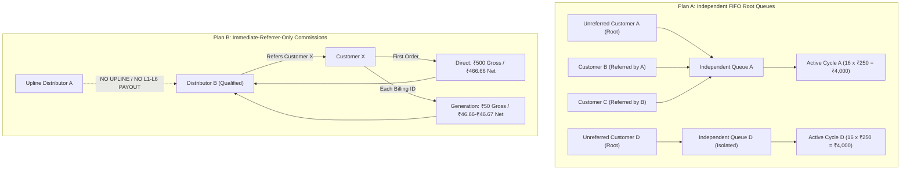
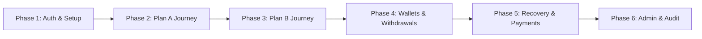

# ShopEasy — Arya Global Digital: Comprehensive Manual Testing Plan

**Document Version:** 1.0.0  
**Effective Date:** 2026-11-17  
**Target Environment:** Local Sandbox (`http://127.0.0.1:8000`) & TiDB Cloud Serverless (`shopeasy_arya`)  
**Schema Revision:** Alembic `f4a5b6c7d8e9` (12 of 12 applied)  
**Authoritative Business Rules:** `05_BUSINESS_RULE_DECISIONS.md`, `PLAN A & PLAN B in detail.pdf` (§26 Precedence)

---

## 1. Architectural Overview & The "No Global Queue" Rule

### 1.1 Strict Architecture Invariant: No Global Queue
> [!IMPORTANT]
> **The legacy global queue is NOT part of the active ShopEasy – Arya Global Digital platform logic.**
>
> 1. **Plan A (Customer Programme):** Uses **independent FIFO cashback queues** scoped strictly to each distinct root customer hierarchy. Each queue independently tracks its own entries, cycle progression, ₹250 contributions, unallocated reserves, and completion state machines.
> 2. **Plan B (Distributor Programme):** Uses direct referral commissions (₹500 gross) and generation commissions (₹50 gross) payable **strictly to the immediate referring distributor**. There is **no global queue**, no multi-level tree, and no L1–L6 upline commission distribution.
> 3. **Legacy Components Deprecated:** `QueueControl`, `BeneficiaryQueue`, and `CommissionCycle` are legacy artifacts from earlier prototypes. They are **not seeded, not activated, not populated**, and must never be referenced by new transactions.
> 4. **Test Plan Invariant:** Testers must never construct test cases assuming a shared global queue. All Plan A multi-customer scenarios must explicitly account for queue isolation.

---

## 2. Test Environment & Safety Prerequisites

### 2.1 Environmental Boundaries
- **Application URL:** `http://127.0.0.1:8000` (FastAPI + Vanilla JS Frontend).
- **Target Database:** TiDB Cloud Serverless database `shopeasy_arya`. Under no circumstances may requests or connections touch `shopeasy_app`.
- **Payment Gateway Simulation:** Active (`ALLOW_SIMULATED_PAYMENTS=true`). Real Razorpay gateway is disabled. Simulated callbacks are triggered via the authenticated sandbox modal.
- **SMS / OTP Authentication:** Development OTP mode active (`OTP_DELIVERY_PROVIDER=dev`). OTP codes appear in sandbox debug headers/logs; live SMS providers are not connected.
- **Background Scheduler:** Fulfilment recovery background scheduler is disabled by default (`FULFILMENT_RECOVERY_ENABLED=false`). Recovery tests must invoke authorized administrative inspection endpoints or manually triggered service methods.
- **Read-Only / Test Data Boundary:** All testing is executed in the isolated sandbox environment. Production customer data must never be entered.

---

## 3. Financial Calculation Standards

All monetary ledger entries use `DECIMAL(14,2)` arithmetic, rounded using `ROUND_HALF_UP` to the nearest paise at ledger boundaries.

### 3.1 Plan A Financial Formulas
- **Direct Referral Commission:**
  $$\text{Gross} = \text{₹750.00}, \quad \text{Op Cost (4.6667\%)} = \text{₹35.00}, \quad \text{TDS (2.0\%)} = \text{₹15.00}, \quad \text{Net} = \text{₹700.00}$$
- **Cashback Contribution:**
  $$\text{Per Qualifying Billing ID} = \text{₹250.00}$$
- **Cashback Cycle Completion:**
  $$\text{16 Contributions} \times \text{₹250.00} = \text{₹4,000.00 Net (Credited to Sequential Commission Wallet)}$$

### 3.2 Plan B Financial Formulas
- **Direct Referral Commission (Lifetime 1st Qualifying Order):**
  $$\text{Gross} = \text{₹500.00}, \quad \text{Op Cost (4.6667\%)} = \text{₹23.34}, \quad \text{TDS (2.0\%)} = \text{₹10.00}, \quad \text{Net} = \text{₹466.66}$$
- **Generation Commission (Per Eligible Billing ID):**
  $$\text{Gross} = \text{₹50.00}, \quad \text{TDS (2.0\%)} = \text{₹1.00}$$
  - First Billing ID (Sample 5 calibration): $\text{Op Cost} = \text{₹2.34}, \quad \text{Net} = \text{₹46.66}$
  - Subsequent Billing IDs: $\text{Op Cost} = \text{₹2.33}, \quad \text{Net} = \text{₹46.67}$
  - Five-unit sample reconciliation: $5 \times \text{₹50} = \text{₹250.00 Gross} \rightarrow \text{₹11.66 Op Cost} + \text{₹5.00 TDS} + \text{₹233.34 Net}$.
  - Combined with Direct: $\text{₹500} + \text{₹250} = \text{₹750.00 Gross} \rightarrow \text{₹35.00 Op Cost} + \text{₹15.00 TDS} + \text{₹700.00 Net}$.

---

## 4. Test Scenarios in Execution Order

---

### Phase 1: Authentication, Registration & Programme Boundaries

#### TC-AUTH-01: Plan A Customer Registration & OTP Login
- **Feature:** Customer Registration & Authentication
- **Preconditions:** Server running; tester has a fresh 10-digit mobile number (`9811100001`).
- **Browser Steps:**
  1. Navigate to `http://127.0.0.1:8000/login.html`.
  2. Select the **Customer** tab.
  3. Enter Mobile Number `9811100001` and click **Request OTP**.
  4. Inspect the dev modal / debug header for the 6-digit OTP code.
  5. Enter the OTP code and submit.
- **Expected Result:** Customer profile created with `role='customer'`, `programme='PLAN_A'`, `is_active=True`. Browser redirects to `dashboard.html`. Referral code generated.
- **Financial Calculation:** N/A (₹0.00).
- **Database Verification:**
  - `SELECT id, role, programme, referral_code FROM users WHERE phone='9811100001';`
  - Expected: `role='customer'`, `programme='PLAN_A'`, `referral_code IS NOT NULL`.
  - Zero wallet records created at this stage.
- **Pass/Fail Criteria:** Pass if customer is authenticated and redirected to customer dashboard without errors.
- **Sandbox Requirement:** Dev OTP only. Admin approval: No.

#### TC-AUTH-02: Plan B Distributor Registration & Password Setup
- **Feature:** Distributor Registration & Dual-Tab Separation
- **Preconditions:** Fresh mobile number (`9822200001`).
- **Browser Steps:**
  1. Navigate to `http://127.0.0.1:8000/login.html`.
  2. Select the **Distributor** tab.
  3. Enter Name "Distributor Alpha", Phone `9822200001`, and Password `Distributor@2026`.
  4. Submit registration form.
- **Expected Result:** Account created with `role='customer'`, `programme='PLAN_B'`, `account_status='ACTIVE'`. Referral code assigned but marked **inactive** for referring others until a qualifying purchase is completed (BR-X2). Redirects to `distributor-dashboard.html`.
- **Financial Calculation:** N/A (₹0.00).
- **Database Verification:**
  - `SELECT id, role, programme, referral_code, is_active FROM users WHERE phone='9822200001';`
  - Expected: `programme='PLAN_B'`.
- **Pass/Fail Criteria:** Pass if distributor portal opens and displays referral status as "Pending Qualifying Purchase".
- **Sandbox Requirement:** None. Admin approval: No.

#### TC-AUTH-03: Administrator Password Login & Security Headers
- **Feature:** Admin Authentication & Security
- **Preconditions:** Admin account provisioned in seed (`Hitesh`).
- **Browser Steps:**
  1. Open Chrome DevTools (Network tab).
  2. Navigate to `http://127.0.0.1:8000/admin/login.html`.
  3. Enter configured administrator phone and password. Click **Sign In**.
- **Expected Result:** Successful authentication, JWT token stored in `sessionStorage`/`localStorage`. Redirects to `/admin/dashboard.html`. Network responses contain security headers (`X-Frame-Options: DENY`, `X-Content-Type-Options: nosniff`, `Content-Security-Policy`).
- **Financial Calculation:** N/A.
- **Database Verification:**
  - `SELECT id, role FROM users WHERE role='admin';` (Count = 1).
- **Pass/Fail Criteria:** Pass if admin dashboard loads live metrics and headers are enforced.
- **Sandbox Requirement:** None. Admin approval: No.

#### TC-AUTH-04: Cross-Programme Phone Collision Rejection
- **Feature:** Identity Programme Isolation (R-04)
- **Preconditions:** `9811100001` registered in Plan A.
- **Browser Steps:**
  1. Navigate to `http://127.0.0.1:8000/login.html`.
  2. Switch to **Distributor** tab.
  3. Attempt to register with Phone `9811100001`.
- **Expected Result:** Registration rejected with clear error: *"Mobile number is already registered under another programme."*
- **Pass/Fail Criteria:** Pass if HTTP 409/400 returned and duplicate record is prevented.
- **Sandbox Requirement:** None. Admin approval: No.

---

### Phase 2: Plan A Customer Journey & Referral Engine

#### TC-PLANA-01: First Unreferred Customer Purchase (Root Queue Initialization)
- **Feature:** Independent Queue Creation & BR-A4 Reserve Allocation
- **Preconditions:** Customer A (`9811100001`) logged in. Catalog contains Power Bank at ₹3,999.
- **Browser Steps:**
  1. Browse to `/products.html`, select Power Bank (Qty 1), click **Add to Cart**.
  2. Navigate to `/checkout.html`. Leave Referral Code blank.
  3. Enter shipping address. Click **Place Order**.
  4. On simulated payment modal, click **Simulate Successful Payment**.
- **Expected Result:** Order confirmed. 1 Billing ID generated (`AGD-000201`). Because this customer is unreferred, they establish **Independent Queue 1**. Since there is no active recipient ahead, their ₹250 contribution routes to **Company-Owned Unallocated Reserve** (BR-A4). Entry #1 becomes `ACTIVE`.
- **Financial Calculation:**
  - Order Total: ₹3,999.00
  - Direct Referral Commission: ₹0.00 (Unreferred, recorded as neutral unallocated pool per BR-A7)
  - Cashback Reserve: ₹250.00 allocated to `plan_a_unallocated_cashback_reserves` (`UNALLOCATED — COMPANY OWNED`)
  - Customer Wallet Balance: ₹0.00
- **Database Verification:**
  - `SELECT * FROM billing_ids WHERE order_id = :order_id;` ➔ `programme='PLAN_A'`, count = 1.
  - `SELECT * FROM plan_a_cashback_queues WHERE root_user_id = :cust_a_id;` ➔ 1 queue record.
  - `SELECT * FROM plan_a_unallocated_cashback_reserves WHERE billing_id = :bid;` ➔ Amount = 250.00.
  - `SELECT status, queue_position FROM plan_a_cashback_entries WHERE billing_id = :bid;` ➔ `status='ACTIVE'`, `queue_position=1`.
  - `SELECT status, completed_contributions FROM plan_a_cashback_cycles WHERE queue_id = :qid;` ➔ `status='ACTIVE'`, count = 0.
- **Pass/Fail Criteria:** Pass if Queue 1 initialized, ₹250 routed to reserve, entry #1 set to ACTIVE, and customer wallet remains ₹0.00.
- **Sandbox Requirement:** Simulated payment callback. Admin approval: No.

#### TC-PLANA-02: Plan A Direct Referral Purchase (Downline Enrolment)
- **Feature:** Direct Referral Commission (₹700 Net) & Queue Enrolment
- **Preconditions:** Customer A's referral code obtained from `/dashboard.html` (e.g., `REF-A123`). Customer B (`9811100002`) registered.
- **Browser Steps:**
  1. Log in as Customer B. Add 1 Power Bank to Cart.
  2. Proceed to `/checkout.html`. In Referral Code field, enter `REF-A123`.
  3. Click **Validate Code** (Must display: *"Valid Plan A Referral"*).
  4. Complete shipping and click **Simulate Successful Payment**.
- **Expected Result:**
  - Order confirmed. Billing ID #2 generated (`AGD-000202`).
  - Customer A receives ₹700 net commission into Direct Referral Wallet.
  - Billing ID #2 joins Customer A's Queue 1.
  - Billing ID #2 contributes ₹250 to Customer A's active Cycle 1 (Progress: 1/16).
  - Customer B's entry enqueues as `WAITING` at `queue_position=2`.
- **Financial Calculation:**
  - Customer A Direct Referral Wallet: Gross ₹750.00 − Op Cost ₹35.00 − TDS ₹15.00 = **₹700.00 Net Credit**.
  - Cycle 1 Progress: Total Earned = ₹250.00, Completed Contributions = 1/16.
- **Database Verification:**
  - `SELECT net_amount, status FROM plan_a_commissions WHERE billing_id = :bid2;` ➔ `net_amount=700.00`, `status='EARNED'`.
  - `SELECT balance FROM wallets WHERE user_id = :cust_a_id AND wallet_type='DIRECT_REFERRAL';` ➔ `700.00`.
  - `SELECT amount, recipient_user_id FROM plan_a_cashback_contributions WHERE contributing_billing_id = :bid2;` ➔ `amount=250.00`, recipient = Customer A.
  - `SELECT status, queue_position FROM plan_a_cashback_entries WHERE billing_id = :bid2;` ➔ `status='WAITING'`, `queue_position=2`.
- **Pass/Fail Criteria:** Pass if Customer A wallet increases by exactly ₹700.00, cycle progress is 1/16, and Customer B is `WAITING` at position 2.
- **Sandbox Requirement:** Simulated payment callback. Admin approval: No.

#### TC-PLANA-03: Plan A Multi-Unit Purchase (3 Units = 3 BIDs & 3 Contributions)
- **Feature:** Multi-Unit Billing ID & Contribution Handling (BR-A1)
- **Preconditions:** Customer C (`9811100003`) registered. Uses Customer A's code `REF-A123`.
- **Browser Steps:**
  1. Log in as Customer C. Add Power Bank with Quantity = 3 to Cart.
  2. Proceed to `/checkout.html`, enter `REF-A123`, click **Validate**.
  3. Complete checkout and click **Simulate Successful Payment**.
- **Expected Result:**
  - Exactly 3 separate Billing IDs allocated (`AGD-000203`, `AGD-000204`, `AGD-000205`).
  - Customer A receives 3 direct referral commissions ($3 \times \text{₹700.00} = \text{₹2,100.00 Net}$).
  - All 3 Billing IDs contribute ₹250 separately to Customer A's active Cycle 1 ($3 \times \text{₹250} = \text{₹750.00}$, progress: 4/16).
  - 3 entries enrolled in Queue 1 at positions 3, 4, 5 (all `WAITING`).
- **Financial Calculation:**
  - Customer A Commission: $3 \times \text{₹700.00} = \text{₹2,100.00 Net}$. New Wallet Balance: $\text{₹700} + \text{₹2,100} = \text{₹2,800.00}$.
  - Cycle 1 Progress: 4/16 contributions ($\text{₹1,000.00}$ accumulated).
- **Database Verification:**
  - `SELECT count(*) FROM billing_ids WHERE order_id = :order_id;` ➔ Count = 3.
  - `SELECT count(*) FROM plan_a_commissions WHERE order_id = :order_id AND status='EARNED';` ➔ Count = 3.
  - `SELECT completed_contributions FROM plan_a_cashback_cycles WHERE id = :cycle1_id;` ➔ 4.
- **Pass/Fail Criteria:** Pass if 3 distinct BIDs created, Customer A wallet credited ₹2,100, and cycle increments by 3.
- **Sandbox Requirement:** Simulated payment callback. Admin approval: No.

#### TC-PLANA-04: Plan A Repeat Purchase with Referral Code (BR-X1)
- **Feature:** Repeat Purchase Attribution & Cashback Exclusion (BR-X1)
- **Preconditions:** Customer B (`9811100002`) already completed 1st order in TC-PLANA-02. Customer D (`9811100004`) registered with referral code `REF-D123`.
- **Browser Steps:**
  1. Log in as Customer B. Add 1 Power Bank to Cart.
  2. Proceed to `/checkout.html`. Apply Customer D's code `REF-D123`.
  3. Validate code and complete simulated payment.
- **Expected Result:**
  - Order confirmed. Billing ID #6 generated.
  - Owner of the newly used code (Customer D) receives ₹700 net commission.
  - **Cashback Engine Bypassed:** Billing ID #6 is completely excluded from cashback queues and cycles. No ₹250 contribution recorded, no queue entry created.
- **Financial Calculation:**
  - Customer D Direct Referral Wallet: +₹700.00 Net.
  - Cashback queues: Zero change in contributions or positions.
- **Database Verification:**
  - `SELECT referrer_id, net_amount FROM plan_a_commissions WHERE billing_id = :bid6;` ➔ `referrer_id=Cust_D`, `net_amount=700.00`.
  - `SELECT count(*) FROM plan_a_cashback_contributions WHERE contributing_billing_id = :bid6;` ➔ 0.
  - `SELECT count(*) FROM plan_a_cashback_entries WHERE billing_id = :bid6;` ➔ 0.
- **Pass/Fail Criteria:** Pass if Customer D gets ₹700 net commission, while cashback tables have zero records for BID #6.
- **Sandbox Requirement:** Simulated payment callback. Admin approval: No.

#### TC-PLANA-05: Second Unreferred Customer (Queue Isolation Verification)
- **Feature:** Independent Queue Isolation (BR-A2)
- **Preconditions:** Customer E (`9811100005`) registered.
- **Browser Steps:**
  1. Log in as Customer E. Add 1 Power Bank to Cart.
  2. In checkout, leave referral code blank. Complete simulated payment.
- **Expected Result:**
  - Customer E establishes **Independent Queue 2**.
  - Queue 2 has its own Cycle 1 (progress: 0/16) and its own reserve entry.
  - Customer A's Queue 1 is completely untouched.
- **Database Verification:**
  - `SELECT count(*) FROM plan_a_cashback_queues;` ➔ Exactly 2 queues.
  - `SELECT root_user_id FROM plan_a_cashback_queues;` ➔ Customer A ID and Customer E ID.
- **Pass/Fail Criteria:** Pass if Queue 2 created without altering Queue 1 state.
- **Sandbox Requirement:** Simulated payment callback. Admin approval: No.

---

### Phase 3: Plan A Cashback Cycle Completion & Reserve Rules

#### TC-CASHBACK-01: Active Recipient Own Subsequent Purchase (BR-A5)
- **Feature:** Active Recipient Own-Purchase Reserve Allocation (BR-A5)
- **Preconditions:** Customer A is currently the `ACTIVE` recipient in Queue 1.
- **Browser Steps:**
  1. Log in as Customer A. Add 1 Power Bank to Cart.
  2. Complete checkout without referral code and simulate payment.
- **Expected Result:**
  - Customer A cannot contribute to their own active cycle.
  - The ₹250 contribution is allocated permanently to `plan_a_unallocated_cashback_reserves` (`UNALLOCATED — COMPANY OWNED`).
  - Customer A's active cycle progress remains unchanged.
  - Customer A's new Billing ID joins Queue 1 tail as `WAITING`.
- **Financial Calculation:**
  - Unallocated Reserve: +₹250.00.
  - Cycle 1 Completed Contributions: Unchanged (still 4/16).
- **Database Verification:**
  - `SELECT amount, status FROM plan_a_unallocated_cashback_reserves WHERE customer_id = :cust_a_id;` ➔ Status = `UNALLOCATED — COMPANY OWNED`.
  - `SELECT completed_contributions FROM plan_a_cashback_cycles WHERE id = :cycle1_id;` ➔ 4.
- **Pass/Fail Criteria:** Pass if ₹250 is recorded in company reserve and cycle contribution count does not increase.
- **Sandbox Requirement:** Simulated payment callback. Admin approval: No.

#### TC-CASHBACK-02: 16-Contribution Cycle Completion & ₹4,000 Credit
- **Feature:** Full Cycle Completion & FIFO Promotion
- **Preconditions:** Queue 1 has 4 contributions. 12 additional qualifying purchases are placed in Queue 1 by downline customers.
- **Browser Steps:**
  1. Execute purchases 5 through 16 under Customer A's hierarchy via checkout simulation.
- **Expected Result:**
  - On the 16th contribution, Cycle 1 transitions to `COMPLETED`.
  - Customer A's **Sequential Commission Wallet** is atomically credited with **₹4,000.00**.
  - Customer A's Queue Entry 1 transitions to `COMPLETED`.
  - Queue Entry 2 (Customer B) automatically activates: status becomes `ACTIVE`, and Cycle 2 is created for Customer B.
  - Admin notification emitted: *"Cashback cycle completed"*.
- **Financial Calculation:**
  - Total Accumulated: $16 \times \text{₹250.00} = \text{₹4,000.00 Net}$.
  - Customer A Sequential Commission Wallet Balance: **₹4,000.00**.
- **Database Verification:**
  - `SELECT status, completed_contributions, total_earned FROM plan_a_cashback_cycles WHERE id = :cycle1_id;` ➔ `status='COMPLETED'`, `completed_contributions=16`, `total_earned=4000.00`.
  - `SELECT balance FROM wallets WHERE user_id = :cust_a_id AND wallet_type='SEQUENTIAL_COMMISSION';` ➔ `4000.00`.
  - `SELECT status FROM plan_a_cashback_entries WHERE id = 2;` ➔ `ACTIVE`.
- **Pass/Fail Criteria:** Pass if Cycle 1 marks completed, ₹4,000 is credited, and Entry 2 becomes ACTIVE.
- **Sandbox Requirement:** Simulated payment callback. Admin approval: No.

---

### Phase 4: Plan B Distributor Journey & Commissions

#### TC-PLANB-01: Distributor Registration & Referral Ineligibility Check
- **Feature:** Referral Code Purchase Requirement (BR-X2)
- **Preconditions:** Distributor Alpha (`9822200001`) registered in TC-AUTH-02, but has completed 0 purchases. Customer F (`9833300001`) registers in Plan B.
- **Browser Steps:**
  1. Log in as Customer F. Add Power Bank to Cart.
  2. In `/checkout.html`, enter Distributor Alpha's referral code. Click **Validate**.
- **Expected Result:** Validation fails with message: *"Distributor referral code is not active for referrals (Qualifying purchase required)."*
- **Pass/Fail Criteria:** Pass if ineligible distributor code cannot be applied to an order.
- **Sandbox Requirement:** None. Admin approval: No.

#### TC-PLANB-02: Distributor Qualifying Self-Purchase (BR-X2 / BR-B3)
- **Feature:** Distributor Self-Purchase & Qualification Activation
- **Preconditions:** Distributor Alpha (`9822200001`) logged in.
- **Browser Steps:**
  1. Browse to `/products.html`, add 1 Power Bank to Cart.
  2. Proceed to `/checkout.html`. (Do not apply any referral code).
  3. Complete checkout and simulate payment.
- **Expected Result:**
  - Order confirmed. Billing ID allocated with `programme='PLAN_B'`.
  - Self-purchase produces **zero commission and zero cashback** (BR-B3).
  - Distributor Alpha is now **qualified** to refer customers (BR-X2).
- **Financial Calculation:** Order: ₹3,999.00. Commission: ₹0.00. Cashback: ₹0.00.
- **Database Verification:**
  - `SELECT programme FROM billing_ids WHERE order_id = :order_id;` ➔ `PLAN_B`.
  - `SELECT count(*) FROM plan_b_commissions WHERE order_id = :order_id;` ➔ 0.
- **Pass/Fail Criteria:** Pass if distributor order completes, zero commissions are paid, and referral code becomes valid.
- **Sandbox Requirement:** Simulated payment callback. Admin approval: No.

#### TC-PLANB-03: Plan B Customer First Qualifying Order (Direct + Generation)
- **Feature:** Plan B Direct (₹466.66 Net) & Generation (₹46.66 Net) Commission
- **Preconditions:** Distributor Alpha is qualified. Customer F (`9833300001`) places first order.
- **Browser Steps:**
  1. Log in as Customer F. Add 1 Power Bank to Cart.
  2. In `/checkout.html`, enter Distributor Alpha's code. Validate (Must show distributor preview).
  3. Place order and simulate payment.
- **Expected Result:**
  - 1 Billing ID generated (`AGD-000207`). Permanent referral relationship established.
  - Distributor Alpha receives **both**:
    1. Direct Referral Commission: ₹500 Gross, ₹23.34 Op Cost, ₹10.00 TDS = **₹466.66 Net**.
    2. Generation Commission: ₹50 Gross, ₹2.34 Op Cost, ₹1.00 TDS = **₹46.66 Net**.
  - Total credited to Distributor Alpha Direct Referral Wallet: **₹513.32**.
- **Financial Calculation:**
  $$\text{Direct Net} = \text{₹466.66}, \quad \text{Generation Net} = \text{₹46.66}, \quad \text{Total} = \text{₹513.32}$$
- **Database Verification:**
  - `SELECT commission_type, gross_amount, operational_cost_amount, tds_amount, net_amount, status FROM plan_b_commissions WHERE order_id = :order_id;`
    - Row 1: `DIRECT`, Gross 500.00, OpCost 23.34, TDS 10.00, Net 466.66.
    - Row 2: `GENERATION`, Gross 50.00, OpCost 2.34, TDS 1.00, Net 46.66.
  - `SELECT balance FROM wallets WHERE user_id = :dist_id AND wallet_type='DIRECT_REFERRAL';` ➔ `513.32`.
- **Pass/Fail Criteria:** Pass if distributor receives exact net credit of ₹513.32 with proper deduction breakdown.
- **Sandbox Requirement:** Simulated payment callback. Admin approval: No.

#### TC-PLANB-04: Plan B Multi-Unit First Order (Direct + Multi-Generation)
- **Feature:** Multi-Unit Generation Payouts & 5-Unit Rounding
- **Preconditions:** Distributor Alpha qualified. Customer G (`9833300002`) places first order with Quantity = 4 Power Banks.
- **Browser Steps:**
  1. Log in as Customer G. Add 4 Power Banks to Cart.
  2. In checkout, apply Distributor Alpha's code. Simulate payment.
- **Expected Result:**
  - 4 Billing IDs generated.
  - Exactly 1 Direct Commission (₹466.66 Net).
  - Exactly 4 Generation Commissions:
    - BID 1: ₹46.66 Net (Op Cost ₹2.34)
    - BID 2: ₹46.67 Net (Op Cost ₹2.33)
    - BID 3: ₹46.67 Net (Op Cost ₹2.33)
    - BID 4: ₹46.67 Net (Op Cost ₹2.33)
  - Generation Total: $46.66 + 46.67 + 46.67 + 46.67 = \text{₹186.67 Net}$.
  - Total Order Commission: $\text{₹466.66} + \text{₹186.67} = \text{₹653.33 Net}$.
- **Pass/Fail Criteria:** Pass if 1 direct and 4 generation records created with exact paise reconciliation.
- **Sandbox Requirement:** Simulated payment callback. Admin approval: No.

#### TC-PLANB-05: Plan B Customer Repeat Order (Generation Only)
- **Feature:** Lifetime Direct Commission Single-Award Invariant
- **Preconditions:** Customer F already awarded direct commission in TC-PLANB-03.
- **Browser Steps:**
  1. Log in as Customer F. Add 1 Power Bank to Cart.
  2. Checkout (referral relationship is already permanently bound). Complete payment.
- **Expected Result:**
  - 1 Billing ID generated.
  - Direct Commission is **skipped** (idempotency key `PB-DIRECT:{cust_f_id}` already exists).
  - Generation Commission is awarded: **₹46.67 Net** (or ₹46.66).
  - Direct Referral Wallet balance increments by Generation amount only.
- **Database Verification:**
  - `SELECT count(*) FROM plan_b_commissions WHERE referee_id = :cust_f_id AND commission_type='DIRECT';` ➔ Exactly 1.
  - `SELECT count(*) FROM plan_b_commissions WHERE referee_id = :cust_f_id AND commission_type='GENERATION';` ➔ 2.
- **Pass/Fail Criteria:** Pass if direct commission is NOT awarded a second time and only generation is credited.
- **Sandbox Requirement:** Simulated payment callback. Admin approval: No.

#### TC-PLANB-06: Non-Retroactive Direct Commission on Later Order (BR-B1)
- **Feature:** Late Referral Code Application
- **Preconditions:** Customer H (`9833300003`) registered. Order 1 placed without referral code.
- **Browser Steps:**
  1. Customer H places Order 1 without referral code. (0 commissions).
  2. On Order 2, Customer H applies Distributor Alpha's code. Simulates payment.
- **Expected Result:**
  - Order 2 establishes permanent referral relationship.
  - Distributor Alpha receives ₹466.66 direct + ₹46.66 generation on Order 2.
  - Zero retrospective commission is awarded for Order 1.
- **Pass/Fail Criteria:** Pass if Order 2 awards direct commission and Order 1 remains uncredited.
- **Sandbox Requirement:** Simulated payment callback. Admin approval: No.

#### TC-PLANB-07: Immediate-Referrer-Only & No L1–L6 Multi-Level Payouts
- **Feature:** Prohibition of Multi-Level Downline Upline Payouts (R-05)
- **Preconditions:** Distributor Alpha referred Distributor Beta (`9822200002`). Distributor Beta refers Customer I (`9833300004`).
- **Browser Steps:**
  1. Customer I places order using Distributor Beta's code. Simulates payment.
- **Expected Result:**
  - Distributor Beta receives Direct (₹466.66) + Generation (₹46.66).
  - **Upline Check:** Distributor Alpha receives **₹0.00**. Zero upline records created.
- **Database Verification:**
  - `SELECT * FROM plan_b_commissions WHERE order_id = :order_id;`
  - Expected: Only `distributor_id = :dist_beta_id`. Zero records for `dist_alpha_id`.
- **Pass/Fail Criteria:** Pass if upline distributor earns nothing and commissions go strictly to the immediate distributor.
- **Sandbox Requirement:** Simulated payment callback. Admin approval: No.

#### TC-PLANB-08: Cross-Programme Referral Restrictions (BR-X3)
- **Feature:** A→B Referral Prohibition & B→A Isolation
- **Preconditions:** Customer A (Plan A) has code `REF-A123`.
- **Browser Steps:**
  1. Attempt to register or checkout in Plan B using `REF-A123`.
- **Expected Result:** Rejected: *"Plan A referral codes cannot refer into Plan B (BR-X3)."*
- **Pass/Fail Criteria:** Pass if A→B referral is rejected.
- **Sandbox Requirement:** None. Admin approval: No.

---

### Phase 5: Account Restrictions, Wallets & Withdrawals

#### TC-RESTRICT-01: Blocked Distributor Ineligible to Earn Commissions
- **Feature:** Account Blocking Commission Restriction (RG-14)
- **Preconditions:** Distributor Alpha is blocked by administrator via `/admin/customers.html` (`account_status='BLOCKED'`).
- **Browser Steps:**
  1. A referred customer places an order using Distributor Alpha's code.
  2. Simulates payment.
- **Expected Result:**
  - Order completes successfully.
  - Plan B commission engine evaluates distributor eligibility at runtime: status is `INELIGIBLE_DISTRIBUTOR`.
  - **Zero commission credited** to Distributor Alpha.
- **Database Verification:**
  - `SELECT count(*) FROM plan_b_commissions WHERE order_id = :order_id;` ➔ 0.
- **Pass/Fail Criteria:** Pass if blocked distributor receives zero wallet credit and zero commission records.
- **Sandbox Requirement:** Simulated payment callback. Admin approval: Admin sets Blocked status.

#### TC-WALLET-01: Plan A Commission Pool Withdrawal (Instant Simulated Payout)
- **Feature:** Direct Referral Wallet Withdrawal (Threshold ₹700)
- **Preconditions:** Customer A has wallet balance = ₹2,800.00 (from TC-PLANA-02 and TC-PLANA-03).
- **Browser Steps:**
  1. Log in as Customer A. Navigate to `/dashboard.html`.
  2. Locate **Direct Referral Commission Wallet**.
  3. Click **Withdraw All Available (₹2,800.00)**.
- **Expected Result:**
  - Balance >= ₹700.00 threshold.
  - Auto-approved instant simulated payout. Receipt generated (`SIM-PAYOUT-...`).
  - Wallet balance reset to **₹0.00**, `total_withdrawn` becomes **₹2,800.00**.
  - Immutable debit record created in `wallet_transactions`.
- **Financial Calculation:** Balance liquidates from ₹2,800.00 to ₹0.00.
- **Database Verification:**
  - `SELECT balance, total_withdrawn FROM wallets WHERE id = :wallet_id;` ➔ `balance=0.00`, `total_withdrawn=2800.00`.
  - `SELECT status, receipt_reference FROM withdrawals WHERE user_id = :cust_a_id;` ➔ `status='COMPLETED'`, receipt not null.
- **Pass/Fail Criteria:** Pass if full balance is withdrawn and marked COMPLETED immediately without requiring admin review.
- **Sandbox Requirement:** None. Admin approval: No.

#### TC-WALLET-02: Plan A Cashback Wallet Withdrawal (Cycle Completed & Admin Approval)
- **Feature:** Cashback Cycle Full ₹4,000 Withdrawal (BR-A6)
- **Preconditions:** Customer A completed 16/16 cycle in TC-CASHBACK-02; Sequential Commission Wallet balance = ₹4,000.00.
- **Browser Steps:**
  1. On `/dashboard.html`, locate **Customer Cashback Wallet**.
  2. Click **Withdraw Full Cashback (₹4,000.00)**.
- **Expected Result:**
  - Request submitted. Admin notification emitted (`PA_ADMIN_CASHBACK_WITHDRAWAL_REQUESTED`).
  - Withdrawal created in `REQUESTED` status (or auto-completed based on active customer status, but strictly requires 16/16 cycle).
  - Attempting to withdraw partial amount (e.g. ₹2,000) is forbidden by UI/API.
- **Pass/Fail Criteria:** Pass if withdrawal validates 16/16 completion and processes full ₹4,000.
- **Sandbox Requirement:** None. Admin approval: Yes (for cashback review).

#### TC-WALLET-03: Blocked Distributor Withdrawal Request (Admin Review Flow)
- **Feature:** Blocked Distributor Payout Review & Approval
- **Preconditions:** Distributor Alpha is `BLOCKED`, has wallet balance = ₹1,166.65.
- **Browser Steps:**
  1. Log in as Distributor Alpha on `/distributor-dashboard.html`.
  2. Click **Request Withdrawal**.
  3. Confirm request dialog.
- **Expected Result:**
  - Withdrawal enters `REQUESTED` status (funds held in wallet).
  - Admin notification emitted (`PB_ADMIN_BLOCKED_WITHDRAWAL_REQUESTED`).
  - Distributor dashboard shows withdrawal status as *"Pending Administrative Review"*.
- **Admin Approval Steps:**
  4. Log in as Administrator on `/admin/withdrawals.html`.
  5. Find Distributor Alpha's pending request. Click **Approve**.
  6. Confirm modal.
- **Post-Approval Result:**
  - Withdrawal transitions from `REQUESTED` to `COMPLETED`.
  - Wallet balance debited to ₹0.00. Receipt issued.
- **Pass/Fail Criteria:** Pass if withdrawal is held until admin explicitly approves it.
- **Sandbox Requirement:** None. Admin approval: Yes.

#### TC-WALLET-04: Blocked Distributor Withdrawal Rejection
- **Feature:** Admin Rejection of Blocked Distributor Withdrawal
- **Preconditions:** Distributor Beta is `BLOCKED`, requests withdrawal of ₹500.00.
- **Browser Steps:**
  1. Log in as Administrator on `/admin/withdrawals.html`.
  2. Locate request, click **Reject**.
  3. Enter Rejection Reason: *"KYC document discrepancy"*. Submit.
- **Expected Result:**
  - Withdrawal status transitions to `REJECTED`.
  - Balance remains in distributor wallet (not forfeited, not deducted).
  - Rejection note recorded in database.
- **Pass/Fail Criteria:** Pass if rejected withdrawal does not debit wallet.
- **Sandbox Requirement:** None. Admin approval: Yes.

#### TC-WALLET-05: Wallet Freezing & Unfreezing by Admin
- **Feature:** Administrative Wallet Freeze State Machine
- **Preconditions:** Customer B has wallet balance = ₹700.00.
- **Browser Steps:**
  1. Admin opens `/admin/customers.html`, selects Customer B.
  2. Clicks **Freeze Wallet**, enters reason: *"Audit investigation"*.
  3. Customer B logs in, attempts to withdraw.
- **Expected Result:** Customer B withdrawal rejected with HTTP 409: *"Wallet is frozen by administrator."*
- **Unfreeze Steps:**
  4. Admin clicks **Unfreeze Wallet**. Customer B re-attempts withdrawal.
- **Expected Result:** Withdrawal succeeds. Audit history recorded in `wallet_freeze_history`.
- **Pass/Fail Criteria:** Pass if frozen wallet strictly prevents withdrawal, while unfreezing restores functionality.
- **Sandbox Requirement:** None. Admin approval: Yes.

---

### Phase 6: Payment Recovery, Replay Safety & Edge Cases

#### TC-PAYMENT-01: Webhook Replay & Idempotency Barrier
- **Feature:** Duplicate Webhook Protection
- **Preconditions:** Order #1 already paid and fulfilled.
- **Browser / API Steps:**
  1. Send duplicate webhook payload for Order #1 with the same `event_id` and `attempt_reference`.
- **Expected Result:**
  - Backend acknowledges webhook with `200 OK`.
  - `PaymentService` detects duplicate in `payment_events`.
  - Zero duplicate Billing IDs, zero duplicate commissions, zero duplicate wallet credits.
- **Pass/Fail Criteria:** Pass if total commissions and wallet balances remain identical before and after replay.
- **Sandbox Requirement:** Sandbox webhook replay. Admin approval: No.

#### TC-PAYMENT-02: Payment Failure Handling & Non-Allocation
- **Feature:** Gateway Failure Safety
- **Preconditions:** Customer adds Power Bank to Cart, proceeds to checkout.
- **Browser Steps:**
  1. On simulated payment modal, select **Simulate Failure** with reason *"Bank server timeout"*.
- **Expected Result:**
  - Order status updates to `CANCELLED` / `FAILED`.
  - Zero Billing IDs created.
  - Zero commissions or cashback queue entries created.
  - Cart contents preserved for re-attempt.
- **Pass/Fail Criteria:** Pass if failure cleanly aborts fulfilment without side effects.
- **Sandbox Requirement:** Simulated failure callback. Admin approval: No.

---

### Phase 7: Administrator Console, Settings, Reports & Audit

#### TC-ADMIN-01: Financial Settings Edit & Audit Trail
- **Feature:** Live Financial Settings & History
- **Preconditions:** Admin logged in at `/admin/settings.html`.
- **Browser Steps:**
  1. Inspect the 14 canonical settings.
  2. Update Plan B `DIRECT_COMMISSION_GROSS` description or test rate with reason: *"Annual inflation review"*.
  3. Save settings.
- **Expected Result:**
  - Setting version increments to 2.
  - History record appended in `financial_settings_history` with `action='UPDATED'`, `changed_by_id=1`, and audit timestamp.
  - Existing commission records remain unchanged.
- **Pass/Fail Criteria:** Pass if version increments, audit trail captures change, and past records are preserved.
- **Sandbox Requirement:** None. Admin approval: Yes (Admin action).

#### TC-ADMIN-02: Stock Replenishment via Append-Only Receipts (OP-01)
- **Feature:** Append-Only Inventory Movements
- **Preconditions:** Admin logged in at `/admin/products.html`.
- **Browser Steps:**
  1. Select Power Bank. Note current stock.
  2. Click **Replenish Stock**. Enter Quantity `500` and Reason: *"Supplier Shipment Batch #99"*. Submit.
  3. Verify stock display updates. Verify direct stock quantity editing is not permitted.
- **Expected Result:** Inventory record appended. Stock increments by 500.
- **Database Verification:**
  - `SELECT quantity, movement_type, reason FROM inventory_movements WHERE product_id = :pid;` ➔ `quantity=500`, `movement_type='RECEIPT'`.
- **Pass/Fail Criteria:** Pass if stock increments solely via audited receipt.
- **Sandbox Requirement:** None. Admin approval: Yes.

#### TC-ADMIN-03: Plan B Excel Report Downloads (.xlsx Only)
- **Feature:** Plan B Reports Format (R-08, R-09)
- **Preconditions:** Plan B orders and commissions exist.
- **Browser Steps:**
  1. Navigate to `/admin/plan-b.html` (or distributor dashboard).
  2. Click **Download Plan B Commission Report**.
  3. Click **Download Individual Distributor Report**.
- **Expected Result:**
  - Valid `.xlsx` spreadsheet files downloaded.
  - Headings reflect approved presentation text (`Direct referral commission`, `₹466.66 Net`, `₹46.66/₹46.67 Net`).
  - **No PDF export option** is provided for Plan B.
- **Pass/Fail Criteria:** Pass if Excel files open cleanly with correct columns and no PDF links exist.
- **Sandbox Requirement:** None. Admin approval: No.

#### TC-ADMIN-04: Plan A PDF & Excel Reports Download
- **Feature:** Plan A Reports Dual Format (R-09)
- **Preconditions:** Plan A orders exist.
- **Browser Steps:**
  1. Navigate to `/admin/reports.html`.
  2. Download Plan A Performance Report in PDF and Excel formats.
- **Expected Result:** Both PDF and Excel files generate and download cleanly with accurate queue and cycle metrics.
- **Pass/Fail Criteria:** Pass if both formats download with matching figures.
- **Sandbox Requirement:** None. Admin approval: No.

---

### Phase 8: Responsive Desktop & Mobile Journeys

#### TC-UI-01: Customer Mobile Viewport Checkout & Dashboard
- **Feature:** Mobile UX (375px & 412px viewports)
- **Preconditions:** Mobile emulation mode enabled in browser DevTools.
- **Browser Steps:**
  1. Set viewport to 375x667 (iPhone SE) and 412x915 (Pixel 7).
  2. Test Storefront (`/`), Cart (`/cart.html`), Checkout (`/checkout.html`), and Dashboard (`/dashboard.html`).
- **Expected Result:**
  - Bottom navigation bar accessible.
  - Modals and payment simulation dialogs scale within viewport without horizontal scrolling.
  - Tap targets >= 44x44px. Zero overlapping text.
- **Pass/Fail Criteria:** Pass if mobile checkout and dashboard workflows operate cleanly without visual regressions.
- **Sandbox Requirement:** None. Admin approval: No.

---

## 5. Negative & Edge Cases Matrix

| Edge Case ID | Scenario | Trigger Action | Expected System Response |
|---|---|---|---|
| **NEG-01** | Non-existent Referral Code | Enter `INVALID999` at checkout | Display: *"Invalid Referral"* (Plan A) or *"Wrong Referral ID"* (Plan B). Order blocked until cleared. |
| **NEG-02** | Expired / Invalid Dev OTP | Enter `000000` or expired OTP | HTTP 400: *"Invalid or expired verification code."* |
| **NEG-03** | Self-Referral Attempt | Customer applies own referral code | Rejected at checkout: *"You cannot apply your own referral code."* |
| **NEG-04** | Withdrawal Below Minimum | Customer with ₹500 balance attempts Direct Referral withdrawal | Rejected: *"Minimum first withdrawal balance is ₹750.00."* |
| **NEG-05** | Incomplete Cycle Cashback Withdrawal | Customer with 12/16 contributions attempts cashback withdrawal | Rejected: *"Sequential Commission withdrawal is only permitted after completing the full 16-commission cycle."* |
| **NEG-06** | Zero Balance Withdrawal | Customer clicks withdraw on empty wallet | HTTP 400: *"No available balance to withdraw."* |
| **NEG-07** | Deactivated Distributor Referral | Referee applies deactivated distributor's code | Rejected: *"Distributor account is deactivated or inactive."* |
| **NEG-08** | Rapid Double-Click Withdrawal | Click withdraw button twice within 100ms | Idempotency barrier prevents duplicate debit; returns original withdrawal. |

---

## 6. Test Execution Checklist

| Test ID | Module / Feature Description | Priority | Prerequisite Tests | Execution Status (PASS / FAIL / BLOCKED) | Tester Sign-off | Run Date | Notes / Observations |
|---|---|---|---|---|---|---|---|
| **TC-AUTH-01** | Plan A Customer Registration & OTP | High | None | `[  ]` | | | |
| **TC-AUTH-02** | Plan B Distributor Registration | High | None | `[  ]` | | | |
| **TC-AUTH-03** | Admin Password Login & Headers | High | None | `[  ]` | | | |
| **TC-AUTH-04** | Cross-Programme Phone Collision | Medium | TC-AUTH-01 | `[  ]` | | | |
| **TC-PLANA-01** | First Unreferred Order (Queue 1 Init) | Critical | TC-AUTH-01 | `[  ]` | | | |
| **TC-PLANA-02** | Plan A Direct Referral Order (₹700 Net)| Critical | TC-PLANA-01 | `[  ]` | | | |
| **TC-PLANA-03** | Plan A Multi-Unit Order (3 BIDs) | High | TC-PLANA-02 | `[  ]` | | | |
| **TC-PLANA-04** | Plan A Repeat Purchase (BR-X1) | Critical | TC-PLANA-02 | `[  ]` | | | |
| **TC-PLANA-05** | Second Unreferred Order (Queue 2 Init) | High | TC-PLANA-01 | `[  ]` | | | |
| **TC-CASHBACK-01**| Recipient Own Subsequent Purchase | High | TC-PLANA-01 | `[  ]` | | | |
| **TC-CASHBACK-02**| 16-Contribution Cycle Completion | Critical | TC-PLANA-03 | `[  ]` | | | |
| **TC-PLANB-01** | Distributor Ineligible Pre-Purchase | High | TC-AUTH-02 | `[  ]` | | | |
| **TC-PLANB-02** | Distributor Self-Purchase Qualification | Critical | TC-PLANB-01 | `[  ]` | | | |
| **TC-PLANB-03** | Plan B First Order (Direct + Gen) | Critical | TC-PLANB-02 | `[  ]` | | | |
| **TC-PLANB-04** | Plan B Multi-Unit Order (5-Unit Sample)| High | TC-PLANB-03 | `[  ]` | | | |
| **TC-PLANB-05** | Plan B Repeat Order (Gen Only) | High | TC-PLANB-03 | `[  ]` | | | |
| **TC-PLANB-06** | Late Referral Code Application (BR-B1) | Medium | TC-PLANB-02 | `[  ]` | | | |
| **TC-PLANB-07** | Immediate-Referrer-Only (No L1-L6) | Critical | TC-PLANB-03 | `[  ]` | | | |
| **TC-PLANB-08** | Cross-Programme Restrictions (BR-X3) | High | TC-PLANA-01 | `[  ]` | | | |
| **TC-RESTRICT-01**| Blocked Distributor Commission Block | Critical | TC-PLANB-03 | `[  ]` | | | |
| **TC-WALLET-01** | Plan A Commission Pool Withdrawal | High | TC-PLANA-02 | `[  ]` | | | |
| **TC-WALLET-02** | Plan A Cashback Wallet Withdrawal | High | TC-CASHBACK-02| `[  ]` | | | |
| **TC-WALLET-03** | Blocked Distributor Withdrawal Flow | High | TC-RESTRICT-01| `[  ]` | | | |
| **TC-WALLET-04** | Blocked Distributor Rejection Flow | Medium | TC-WALLET-03 | `[  ]` | | | |
| **TC-WALLET-05** | Admin Wallet Freeze & Unfreeze | High | TC-PLANA-02 | `[  ]` | | | |
| **TC-PAYMENT-01**| Webhook Replay & Idempotency | Critical | TC-PLANA-01 | `[  ]` | | | |
| **TC-PAYMENT-02**| Payment Failure Handling | Medium | TC-AUTH-01 | `[  ]` | | | |
| **TC-ADMIN-01** | Financial Settings Edit & Audit Trail | High | TC-AUTH-03 | `[  ]` | | | |
| **TC-ADMIN-02** | Stock Replenishment Receipts | High | TC-AUTH-03 | `[  ]` | | | |
| **TC-ADMIN-03** | Plan B Excel Reports Download | Medium | TC-PLANB-03 | `[  ]` | | | |
| **TC-ADMIN-04** | Plan A PDF & Excel Reports Download | Medium | TC-PLANA-01 | `[  ]` | | | |
| **TC-UI-01** | Mobile Responsive Viewport Testing | Medium | None | `[  ]` | | | |

---

## 7. Known Limitations & Sandbox Caveats

1. **Simulated Payments Only:** Live payment gateways (e.g. Razorpay) are not active. All payment testing relies on `POST /api/v1/payments/simulated/simulate`.
2. **Development OTP:** Real SMS delivery is disabled. Testing accounts read OTPs from the application UI or dev responses.
3. **Background Fulfilment Scheduler:** In local development, `FULFILMENT_RECOVERY_ENABLED` is `False`. Fulfilment is executed synchronously on webhook receipt; automated background sweeps do not run unless explicitly enabled in configuration.
4. **Independent Queue Multi-Purchase Edge Case (BR-A2):** A customer's initial purchase determines their root queue. If a customer subsequently uses a different referral code on a later purchase, BR-X1 assigns commission to the new referrer, but that repeat purchase does not enter cashback queues.

---

## 8. Final Readiness Assessment

- **System Status:** Application server is running and verified healthy on `http://127.0.0.1:8000`.
- **Database Status:** TiDB Cloud database `shopeasy_arya` is connected and clean (1 Admin, 14 Financial Settings, 0 customers, 0 orders, 0 wallets, 0 queue_control records).
- **Alembic Migrations:** All 12 revisions applied through `f4a5b6c7d8e9`.
- **Automated Tests:** 109/109 automated tests passing across 8 test suites.
- **Readiness Conclusion:** **READY FOR MANUAL TESTING EXECUTION.**
